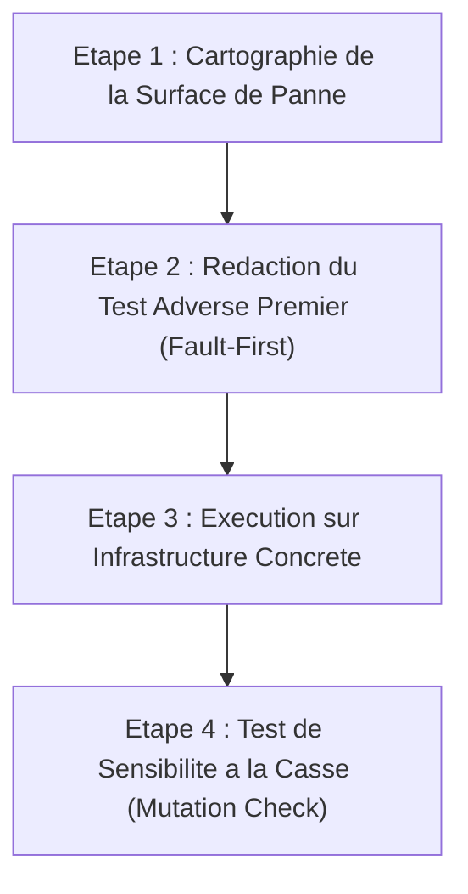

# Agentic Testing Rigor — Principes Dan Luu

## 1. Contexte & Fondements Empiriques

Les recherches de Dan Luu (2026, *How well do agents use test and verification techniques?*) demontrent que :
- La generation de code par LLM est abondante mais fragile (*agent reliability cliff*).
- Les injonctions generiques de test (*"fais du TDD"*, *"utilise du property testing"*) echouent statistiquement.
- L'agent a une propension naturelle a tomber dans le **piege du TDD** : generer des dizaines de tests unitaires tautologiques (getters, setters, mocks retournant des valeurs pre-programmees) qui atteignent artificiellement une couverture elevee (Jacoco >= 80%) sans jamais tester les pannes reelles.
- **La verification est le veritable goulet d'etranglement.** Cette competence agit comme un systeme de contraintes comportementales actives empechant les raccourcis paresseux de l'agent.

---

## 2. Contraintes Comportementales Inviolables (Anti-Lazy Shortcuts)

L'agent a l'interdiction formelle de :
1. **Ecrire des tests sur de simples DTOs ou getters/setters** dans l'unique but de gonfler la couverture Jacoco.
2. **Mocker la couche de persistance relationnelle** pour tester des transactions critiques (ex: verrous 2PC, contraintes d'unicite). Les tests de persistance doivent s'executer sur une base reelle en memoire (`@DataJpaTest` sur H2 ou Testcontainers PostgreSQL).
3. **Mocker unitairement la totalite d'un composant** au point que le test teste la configuration du mock et non la logique metier.
4. **Tester uniquement le cas nominal (Happy Path)**. Tout developpement doit comporter au moins 50% de tests dedies aux chemins de defaillance (*Fault Paths*).

---

## 3. Le Cycle de Verification Dan Luu en 4 Etapes



### Etape 1 : Cartographie de la Surface de Panne
Avant d'ecrire la moindre ligne de test ou de code fonctionnel, l'agent dresse explicitement la liste des modes de defaillance possibles :
- Refus de debit bancaire (HTTP 402 avec Problem Details RFC 7807).
- Conflit d'acces concurrentiel ou rupture de stock (`SELECT FOR UPDATE` bloque ou echoue).
- Timeout ou coupure reseau lors de l'appel a un microservice partenaire.
- Violation de contrainte d'integrite SQL (unicite, cle etrangere orpheline).
- Transition d'etat illegale dans la machine a etats de commande.

### Etape 2 : Redaction du Test Adverse Premier (Fault-First)
Le premier test redige DOIT etre un test d'echec controlé :
- Exemple : Simuler un refus HTTP 402 sur le client bancaire et verifier que le coordinateur 2PC bascule la commande en `RELEASED` et libere les reservations de stock.
- Exemple : Tenter de creer un compte avec un email deja existant et verifier que la transaction leve une exception avec code HTTP 409 et Problem Details RFC 7807.

### Etape 3 : Execution sur Infrastructure Concrete
- Privilegier `@DataJpaTest` pour les repositories JPA afin de verifier la generation du schema DDL, les contraintes SQL et les transactions.
- Employer `MockRestServiceServer` avec de vrais payloads JSON d'erreur plutot que de simples stubs Mockito sans deserialisation.
- Utiliser le conteneurise `bank-mock` de Rayane pour les tests d'interconnexion Docker Compose.

### Etape 4 : Test de Sensibilite a la Casse (Mutation Check)
Pour certifier qu'un test est pertinent :
- L'agent doit mentalement ou reellement desactiver la ligne de code assurant la reparation (ex: commenter l'appel `compensateStock()`).
- Si le test passe encore alors que le comportement critique est retire, **le test est invalide et doit etre reecrit**.

---

## 4. Matrice de Verification Concrete pour Spring Boot 3.3

### A. Test de Persistance Relationnelle Reelle (Sans Mockito)
```java
@DataJpaTest
@AutoConfigureTestDatabase(replace = AutoConfigureTestDatabase.Replace.ANY)
class OrderPersistenceTest {

    @Autowired
    private OrderRepository orderRepository;

    @Test
    @DisplayName("La persistance refuse une commande orpheline sans articles valides")
    void shouldFailOnInvalidOrder() {
        // Verification reelle des contraintes SQL (Not Null, Foreign Key, Enum)
    }
}
```

### B. Test du Client REST avec Verification d'Erreur RFC 7807
```java
@RestClientTest(BankClient.class)
class BankClientTest {

    @Autowired
    private BankClient bankClient;

    @Autowired
    private MockRestServiceServer server;

    @Test
    @DisplayName("Capture formelle du refus HTTP 402 et emission du resultat failed")
    void shouldHandleBankRefusal402() {
        server.expect(requestTo("http://localhost:8084/api/v1/payments/debit"))
              .andRespond(withStatus(HttpStatus.PAYMENT_REQUIRED)
              .contentType(MediaType.APPLICATION_PROBLEM_JSON)
              .body("{\"type\":\"urn:shoploc:payment:refusal\",\"status\":402,\"title\":\"Payment Required\"}"));

        PaymentResult result = bankClient.debit(new PaymentDebitRequest(...));
        assertThat(result.isSuccess()).isFalse();
        assertThat(result.failureReason()).isEqualTo("PAYMENT_REFUSED");
    }
}
```

### C. Test de Compensation Transactionnelle (Coordinateur 2PC)
```java
@Test
@DisplayName("Sur refus bancaire HTTP 402, le coordinateur annule la commande et relache les stocks")
void shouldTriggerRollbackOnPaymentFailure() {
    // 1. Given un panier multi-boutiques valide
    // 2. When la banque renvoie HTTP 402
    // 3. Then la commande bascule a RELEASED
    // 4. And l'appel de compensation de stock est execute a 100%
}
```
