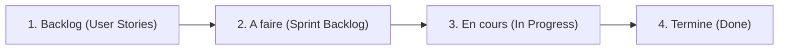

# Guide de Gestion du Backlog, Convention des Tickets & Sprints Linear
## Projet ShopLoc - Societe Garik - Master 2 MIAGE GLOP (2026-2027) - Universite de Lille

---

## 1. Contexte & Constat Initial : Pourquoi Cette Mise au Point ?

Lors de l'utilisation de la plateforme de gestion de projet Linear (`Projet-GLOP`), plusieurs interrogations legitimes ont emerge au sein de l'equipe :
1. **Surcharge visuelle du tableau** : Presence de 8 colonnes d'etats generant un encombrement inutile et un manque de lisibilite du flux Kanban.
2. **Impression de terminer les User Stories trop vite** : Confusion optique entre la validation d'une User Story entiere et l'achevement d'une simple sous-tache technique unitaire.
3. **Absence apparente de Sprints** : Impression de developpement en continu "en bloc" (*Big Bang*) sans fenetres d'iteration temporelle formelles.
4. **Comprehension de la nomenclature** : Besoin de clarifier la signification des prefixes de tickets (`[US-XX]`, `[US-XX-TYY]`, `[DEVOPS-XX]`).

Le present document formalise les regles de gestion du backlog Linear pour l'ensemble des cinq membres de l'equipe Garik (Khalil, Abdelkader, Gautam, Rayane, Ilyas) afin de garantir une synchronisation et une transparence totales.

---

## 2. Distinction Fondamentale : User Stories vs Taches Techniques

### 2.1. L'Illusion d'"Achevement Eclair"
L'impression que des User Stories etaient bouclees en une seule heure provenait d'une confusion entre deux niveaux d'abstraction :
* **Niveau 1 : La User Story (Macro-Fonctionnalite Metier)** :
  - Represente un besoin citoyen ou commercant de bout en bout (ex: `[US-10] Choix du Creneau de Retrait chez Chaque Commercant`).
  - Une User Story requiert plusieurs composants : base de donnees, controleurs REST, securite, tests d'integration et interface utilisateur React.
  - Elle **ne peut pas** etre terminee en une demi-journee. Elle reste dans le **Backlog** tant que l'ensemble de ses sous-taches n'est pas complete.
* **Niveau 2 : La Tache Technique (Micro-Composant Atomique INVEST)** :
  - Represente un increment logiciel de 1 a 3 heures, assigne a un seul etudiant (ex: `[US-10-T01] Modele JPA Order, SubOrder & Statuts de Commande`).
  - Lorsque Khalil termine ses entites JPA et ses tests relationnels, c'est **la tache technique T01** qui passe a `Termine (Done)`, et non la User Story `US-10` entiere.

---

## 3. Convention de Nommage des Tickets Linear

Chaque ticket dans Linear est formate selon une nomenclature standardisee conforme aux exigences academiques du Master 2 MIAGE :

### 3.1. Format des User Stories (Macro)
```text
[US-XX] Titre synthetique du besoin fonctionnel
```
* `US-XX` : Numero de la User Story tel que defini dans le Cahier des Charges R1 (de `US-01` a `US-18`).
* Exemple : `[US-07] Constitution du Panier Multi-Boutiques`.

### 3.2. Format des Taches Techniques de Developpement (Micro)
```text
[US-XX-TYY] Titre explicite du composant ou de la couche technique
```
* `US-XX` : Reference a la User Story parente.
* `TYY` : Identifiant de la couche technique specialisee :
  - **`T01` - Couche Persistance & Modele relationnel** :
    Entites JPA, repositories Spring Data, migrations DDL PostgreSQL, contraintes d'integrite SQL.
  - **`T02` - Couche Service & Endpoints REST** :
    Controleurs Spring MVC, validation Jakarta (`@Valid`), Problem Details RFC 7807, logique metier.
  - **`T03` - Couche Verification & Tests Dan Luu** :
    Tests unitaires TDD, integration `@DataJpaTest` / `@RestClientTest`, scenarios d'erreur (HTTP 402/400), couverture Jacoco >= 80%.
  - **`T00` - Passerelles & Clients Inter-Services** :
    Clients HTTP `RestClient` (ex: `BankClient`, `CatalogClient`) consommant des simulateurs ou services tiers.
* Exemples :
  - `[US-10-T01] Modele JPA Order, SubOrder & Statuts de Commande` (Session 1 Khalil - Fait).
  - `[US-10-T03] Tests Unitaires Confirmation Commande & QR Code` (Session 1 Khalil - Fait).
  - `[US-09-T00] Client HTTP Bancaire RestClient & Resilience RFC 7807 (BankClient)` (Session 2 Khalil - Fait).

### 3.3. Format des Taches Transverses DevOps
```text
[DEVOPS-XX] Titre de l'infrastructure ou de l'outillage
```
* Concerne les conteneurs Docker Compose, simulateurs OpenAPI 3.1 (`bank-mock`), pipelines GitLab CI et scripts FinOps.
* Exemples :
  - `[DEVOPS-01] Orchestration Docker Compose Multi-Bases PostgreSQL 16 & Microservices`.
  - `[DEVOPS-02] Simulateur Mock Bancaire OpenAPI 3.1 Conteneurise (HTTP 200 / 402)`.

---

## 4. Simplification du Tableau Linear (Passage de 8 a 4 Colonnes)

Le tableau comptait initialement 8 etats, dont 3 colonnes de travail en cours redondantes (`In Dev`, `In Review & QA`, `CI/CD`).

Le workflow a ete rationalise en **4 colonnes canoniques** de style Scrum/Kanban :



| Colonne | Type d'Etat | Description & Criteres d'Entree / Sortie |
|---|---|---|
| **1. Backlog (User Stories)** | `backlog` | Contient les 18 User Stories globales du projet R1. Aucune tache technique n'est executee ici : ce sont les objectifs fonctionnels macro. |
| **2. A faire (Sprint Backlog)** | `unstarted` | Taches techniques T01/T02/T03 priorisees et engagees pour le Sprint actif de deux semaines. |
| **3. En cours (In Progress)** | `started` | Tache technique actuellement developpee en local par son responsable (une seule tache active a la fois par etudiant). |
| **4. Termine (Done)** | `completed` | Tache livree repondant a la Definition of Done : code merge, `mvn test` affichant 0 echec et 0 erreur, Jacoco >= 80%, zero trace d'IA. |

*(Les etats de service `Canceled` et `Duplicate` sont conserves en arriere-plan pour les tickets obsoletes).*

---

## 5. Gestion des Sprints dans Linear (Cycles de 2 Semaines)

### 5.1. Pourquoi les Sprints Etaient Invisibles ?
Dans les parametres de l'equipe `Projet-GLOP`, l'option native Linear `cyclesEnabled` etait desactivee par defaut (`false`). Tous les tickets figuraient donc sur un tableau unique sans decoupage temporel, donnant l'impression erronee d'un developpement massif et desordonne.

### 5.2. Activation et Planification des Sprints (Jalon R4 - Decembre 2026)
L'option des Cycles a ete officiellement activee avec une cadence stricte de **2 semaines par Sprint** :

* **Sprint 1 (Actif du 10 au 29 Novembre 2026)** :
  - *Focus* : Socle securite RBAC & Auth (`US-01`, `US-02` - Abdelkader), fiches boutiques et produits (`US-03`, `US-04` - Gautam), socle commande JPA & client bancaire (`US-10`, `US-09-T00` - Khalil), Docker & simulateur OpenAPI 3.1 (`DEVOPS-01`, `DEVOPS-02` - Rayane).
* **Sprint 2 (Du 29 Novembre au 13 Decembre 2026)** :
  - *Focus* : Panier multi-commerces (`US-07`), Moteur coordinateur Two-Phase Commit 2PC et verrous pessimistes (`US-08`, `US-09` - Khalil Session 3), validation du QR code de retrait (`US-11` - Abdelkader / Ilyas), tests de bout-en-bout.
* **Sprint Final / Stabilisation (13 au 18 Decembre 2026)** :
  - *Code Freeze* au 15 decembre 2026.
  - Repetition generale de la demonstration live (Actes 1 a 4) pour la soutenance R4.

---

## 6. Synthese des Responsabilites pour l'Equipe Garik

Chaque developpeur respecte la regle agentique : **1 Session = 1 Tache Technique**.

1. Prendre une tache technique dans **`A faire (Sprint Backlog)`**.
2. La basculer a **`En cours (In Progress)`** et se l'assigner nominativement.
3. Developper selon la discipline TDD Dan Luu (tester les chemins de panne d'abord).
4. Prouver la conformite console (`mvn test`, Jacoco >= 80%).
5. Pousser les commits modulaires et basculer le ticket a **`Termine (Done)`**.
