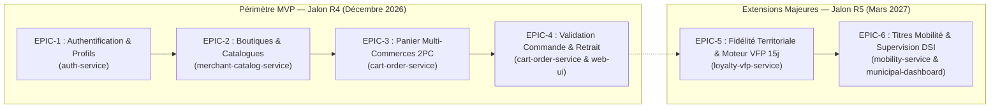

# BACKLOG AGILE INVEST & CADRAGE MVP SHOPLOC (R1 - R4 / R5)

## 1. Contexte Méthodologique & Principes d'Ingénierie

### 1.1. Contexte du Projet & Arbitrage de Soutenance R1
À l'issue de la soutenance du Cahier des Charges R1 (Master 2 MIAGE - UE GLOP 2026-2027), la Maîtrise d'Ouvrage (professeurs évaluateurs) a confirmé la nécessité d'un recentrage pragmatique sur la période effective de développement du premier semestre (octobre à décembre 2026, jalon contractuel R4).

Pour répondre à l'exigence d'une **architecture en microservices distribués** (alignée sur les enseignements ALOM de l'Université de Lille) et garantir une livraison de haute fiabilité sans surcharge, l'équipe Garik a calibré le périmètre du **Produit Minimum Viable (MVP)** :
* **Cœur du MVP pour R4 (Décembre 2026)** : Un composant vertical complet déployé et testé sous TDD : **La Commande & Panier Multi-Commerces Click & Collect sous protocole Two-Phase Commit (2PC)**, appuyé sur le microservice d'authentification (`auth-service`) et le catalogue des boutiques (`catalog-service`).
* **Extension Majeure pour R5 (Mars 2027)** : Le moteur de fidélité territoriale VFP (règle d'expiration dynamique à 15 jours), les titres de mobilité urbaine (Ilévia / parking) et la supervision municipale DSI k-anonyme.

---

### 1.2. Application Rigoureuse du Standard INVEST
Chaque User Story de ce backlog respecte scrupuleusement les critères de qualité logicielle **INVEST** :
* **I (Independent)** : Chaque story est découplée au maximum des autres grâce à l'isolation par microservice.
* **N (Negotiable)** : La story décrit une intention fonctionnelle et un résultat métier, laissant les détails d'implémentation négociables au sein du sprint.
* **V (Valuable)** : Chaque story apporte une valeur mesurable à l'un des personas du projet (Pierre 74 ans, Léa 28 ans, Marc Boulanger, Mairie de Lille).
* **E (Estimable)** : La charge est calibrée en Story Points (suite de Fibonacci : 1, 2, 3, 5, 8).
* **S (Small)** : Aucune story n'excède 8 Story Points (dimensionnée pour être réalisée en 2 à 4 jours homme).
* **T (Testable)** : Chaque story inclut ses critères d'acceptation rédigés selon la syntaxe formelle **Gherkin** (`Given / When / Then`).

---

### 1.3. Definition of Done (DoD) Transverse
Aucune User Story ne peut être déclarée « Done » sans satisfaire l'intégralité des exigences suivantes :
1. **Tests & Couverture** : Tests unitaires et d'intégration écrits avant le code (TDD) via JUnit 5, avec une couverture de code Jacoco minimale de $80\,\%$.
2. **Contrats d'API** : Spécifications OpenAPI 3.1 à jour et conformes au format d'erreur RFC 7807 (Problem Details).
3. **Intégration Continue** : Pipeline GitLab CI (`gitlab-classrooms/autograding` via `maven-junit.yml`) exécuté avec 0 erreur et 0 échec.
4. **Accessibilité & Ergonomie** : Interface React conforme RGAA / WCAG niveau AA (contrastes $\ge 4.5:1$, navigation clavier complète, persona Pierre).
5. **Étancheité IA Absolue** : Zéro fichier `.antigravity`, zéro script d'IA et zéro mention d'agent dans les dépôts de code GitLab.
6. **Politique Zéro Emoji** : Aucun caractère emoji dans le code source, les commentaires, les commits et la documentation.

---

## 2. Cartographie des Epics



---

## 3. Décomposition Détaillée des User Stories (INVEST & Gherkin)

### EPIC 1 : Authentification & Gestion des Profils (`auth-service`)

#### US-01 : Inscription Sécurisée Multi-Rôles
* **En tant que** nouvel utilisateur (Citoyen ou Commerçant),  
* **Je veux** créer un compte avec mon adresse email et un mot de passe robuste,  
* **Afin de** pouvoir accéder de manière sécurisée aux fonctionnalités de ShopLoc adaptées à mon rôle.
* **Estimation** : 3 SP | **Priorité** : Must Have (R4) | **Microservice** : `auth-service`
* **Scénario d'acceptation Gherkin** :
  ```gherkin
  Fonctionnalité: Inscription utilisateur multi-rôles
    Scénario: Inscription réussie d'un citoyen
      Étant donné que je suis un nouvel utilisateur sur le formulaire d'inscription
      Quand je renseigne l'email "pierre.dupont@orange.fr", un mot de passe conforme et le rôle "CITOYEN"
      Alors mon compte est créé dans la base de données auth_db avec un mot de passe haché par BCrypt
      Et le service retourne un statut HTTP 201 Created avec l'identifiant public du compte.

    Scénario: Échec si l'adresse email existe déjà
      Étant donné qu'un compte existe déjà avec l'email "pierre.dupont@orange.fr"
      Quand je tente de créer un compte avec cette même adresse email
      Alors le service retourne un statut HTTP 409 Conflict au format RFC 7807
      Et le message précise que le compte est déjà existant.
  ```

#### US-02 : Connexion Sécurisée & Émission de Token JWT
* **En tant qu'** utilisateur inscrit,  
* **Je veux** m'authentifier avec mes identifiants,  
* **Afin d'** obtenir un jeton JWT contenant mon rôle et mes autorisations pour dialoguer avec les microservices.
* **Estimation** : 2 SP | **Priorité** : Must Have (R4) | **Microservice** : `auth-service`
* **Scénario d'acceptation Gherkin** :
  ```gherkin
  Fonctionnalité: Authentification et délivrance de token
    Scénario: Authentification valide
      Étant donné que mes identifiants sont valides
      Quand j'envoie une requête POST sur "/api/v1/auth/login" avec mon email et mot de passe
      Alors le service me retourne un statut HTTP 200 OK
      Et la réponse contient un jeton JWT signé avec une durée de validité de 2 heures
      Et le jeton contient les claims "sub", "role" et "userId".
  ```

---

### EPIC 2 : Boutiques, Catalogues & Gestion des Stocks (`merchant-catalog-service`)

#### US-03 : Consultation des Boutiques Partenaires
* **En tant que** citoyen local (ex: Pierre ou Léa),  
* **Je veux** consulter la liste et la fiche détaillée des commerces adhérents de mon quartier,  
* **Afin de** découvrir leurs horaires d'ouverture, leur adresse et leurs coordonnées.
* **Estimation** : 2 SP | **Priorité** : Must Have (R4) | **Microservice** : `merchant-catalog-service`
* **Scénario d'acceptation Gherkin** :
  ```gherkin
  Fonctionnalité: Découverte des boutiques locales
    Scénario: Consultation des boutiques actives
      Étant donné que 5 commerçants sont enregistrés et actifs dans la ville
      Quand j'envoie une requête GET sur "/api/v1/merchants"
      Alors le service me renvoie une liste de 5 boutiques avec nom, adresse et horaires
      Et le temps de réponse est inférieur à 200 millisecondes.
  ```

#### US-04 : Consultation du Catalogue Produits d'une Boutique
* **En tant que** client citoyen,  
* **Je veux** visualiser les produits disponibles chez un commerçant avec leur prix unitaire et leur disponibilité,  
* **Afin de** sélectionner les articles que je souhaite réserver en Click & Collect.
* **Estimation** : 3 SP | **Priorité** : Must Have (R4) | **Microservice** : `merchant-catalog-service`
* **Scénario d'acceptation Gherkin** :
  ```gherkin
  Fonctionnalité: Consultation du catalogue commerçant
    Scénario: Affichage des articles disponibles
      Étant donné que la Boulangerie Saint-Michel propose 3 baguettes et 2 croissants en stock
      Quand je consulte l'endpoint "/api/v1/merchants/{id}/products"
      Alors je reçois la liste des produits avec identifiant, libellé, prix TTC et quantité en stock.
  ```

#### US-05 : Gestion des Fiches Produits & Stocks par le Commerçant
* **En tant que** commerçant partenaire (ex: Marc le boulanger),  
* **Je veux** ajouter, modifier ou désactiver un produit et ajuster mon niveau de stock,  
* **Afin de** maintenir mon catalogue Click & Collect parfaitement synchronisé avec mes disponibilités réelles.
* **Estimation** : 3 SP | **Priorité** : Must Have (R4) | **Microservice** : `merchant-catalog-service`
* **Scénario d'acceptation Gherkin** :
  ```gherkin
  Fonctionnalité: Gestion de stock commerçant
    Scénario: Mise à jour du stock d'un article
      Étant donné que je suis authentifié avec le rôle "COMMERCANT" pour la boutique 101
      Quand j'envoie une requête PATCH sur "/api/v1/merchants/101/products/202/stock" avec quantity=15
      Alors le stock de l'article 202 passe à 15 unités
      Et le service retourne HTTP 200 OK.
  ```

#### US-06 : Vérification & Réservation Temporaire de Stock (Endpoint Pré-Commit 2PC)
* **En tant que** microservice de commande (`cart-order-service`),  
* **Je veux** interroger le catalogue pour vérifier et verrouiller temporairement un lot d'articles,  
* **Afin d'** exécuter la phase 1 (Prepare) de la transaction distribuée Click & Collect.
* **Estimation** : 5 SP | **Priorité** : Must Have (R4) | **Microservice** : `merchant-catalog-service`
* **Scénario d'acceptation Gherkin** :
  ```gherkin
  Fonctionnalité: Réservation de stock 2PC (Phase Prepare)
    Scénario: Réservation réussie de stock
      Étant donné que le produit 202 dispose de 10 unités en stock
      Quand cart-order-service demande une réservation de 2 unités avec un TTL de 10 minutes
      Alors le service place 2 unités sous statut "RESERVED"
      Et le service renvoie un statut HTTP 200 OK avec un identifiant de réservation "res-789".

    Scénario: Échec de réservation pour rupture de stock
      Étant donné que le produit 202 ne dispose que de 1 unité en stock
      Quand cart-order-service demande une réservation de 3 unités
      Alors le service refuse la réservation et retourne HTTP 409 Conflict
      Et aucun stock n'est débité.
  ```

---

### EPIC 3 : Panier Multi-Commerces & Two-Phase Commit (`cart-order-service`) — CŒUR DU MVP

#### US-07 : Constitution du Panier Multi-Boutiques
* **En tant que** citoyen effectuant ses courses de quartier,  
* **Je veux** ajouter dans un même panier virtuel des articles issus de plusieurs commerces différents (ex: pain chez le boulanger et viande chez le boucher),  
* **Afin de** regrouper mes achats de proximité en une seule commande centralisée.
* **Estimation** : 5 SP | **Priorité** : Must Have (R4) | **Microservice** : `cart-order-service`
* **Scénario d'acceptation Gherkin** :
  ```gherkin
  Fonctionnalité: Panier multi-boutiques
    Scénario: Ajout d'articles de deux commerçants distincts
      Étant donné un panier actif pour l'utilisateur Pierre
      Quand j'ajoute 1 baguette (Boulangerie A) et 2 pavés de bœuf (Boucherie B)
      Alors mon panier contient 2 sous-ensembles marchands distincts
      Et le montant total du panier est la somme exacte des sous-totaux respectifs.
  ```

#### US-08 : Orchestration de la Transaction 2PC (Phase Prepare & Commit)
* **En tant que** moteur de commande (`cart-order-service`),  
* **Je veux** orchestrer une transaction distribuée Two-Phase Commit auprès de l'ensemble des commerçants du panier,  
* **Afin de** garantir qu'aucun client ne paie une commande si un des commerçants est en rupture de stock inopinée.
* **Estimation** : 8 SP | **Priorité** : Must Have (R4) | **Microservice** : `cart-order-service`
* **Scénario d'acceptation Gherkin** :
  ```gherkin
  Fonctionnalité: Protocole Two-Phase Commit (2PC)
    Scénario: Validation nominale (Tous les commerçants confirment)
      Étant donné un panier multi-commerces avec Boulangerie A et Boucherie B
      Quand l'utilisateur déclenche la validation de commande
      Alors cart-order-service envoie une requête PREPARE à chaque service commerçant
      Et si Boulangerie A et Boucherie B répondent positivement
      Alors cart-order-service émet un message COMMIT définitif
      Et la commande passe à l'état "CONFIRMED".

    Scénario: Rollback automatique (Un commerçant refuse ou ne répond pas)
      Étant donné un panier avec Boulangerie A et Boucherie B
      Quand cart-order-service envoie une requête PREPARE
      Et que Boucherie B répond par un refus de stock (HTTP 409)
      Alors cart-order-service envoie un ordre de ROLLBACK immédiat à Boulangerie A
      Et la commande passe à l'état "CANCELLED_STOCK_UNAVAILABLE"
      Et aucun compte client n'est débité.
  ```

#### US-09 : Sécurité des Pannes Transactionnelles (Timeout & Compensation Automatique)
* **En tant qu'** administrateur système,  
* **Je veux** que toute réservation 2PC non confirmée dans un délai de 10 minutes soit automatiquement libérée,  
* **Afin d'** éviter le blocage injustifié des stocks des commerçants en cas de défaillance réseau ou d'abandon du client.
* **Estimation** : 5 SP | **Priorité** : Must Have (R4) | **Microservice** : `cart-order-service`
* **Scénario d'acceptation Gherkin** :
  ```gherkin
  Fonctionnalité: Gestion des pannes et timeout 2PC
    Scénario: Expiration du délai de réservation
      Étant donné une réservation "res-789" émise à 14h00 avec un timeout de 10 minutes
      Quand le délai de 10 minutes est dépassé sans réception du signal COMMIT
      Alors le démon de compensation libère automatiquement le stock réservé
      Et le statut de la réservation devient "EXPIRED_RELEASED".
  ```

---

### EPIC 4 : Validation de Commande & Interface Click & Collect (`web-ui` & `cart-order-service`)

#### US-10 : Choix du Créneau de Retrait chez Chaque Commerçant
* **En tant que** client citoyen,  
* **Je veux** sélectionner un créneau horaire de passage chez chaque artisan de mon panier,  
* **Afin d'** organiser mon parcours de retrait pédestre sans faire la queue.
* **Estimation** : 3 SP | **Priorité** : Must Have (R4) | **Microservice** : `web-ui` / `cart-order-service`
* **Scénario d'acceptation Gherkin** :
  ```gherkin
  Fonctionnalité: Choix des créneaux de retrait
    Scénario: Sélection de créneaux cohérents
      Étant donné une commande multi-boutiques validée
      Quand je choisis le créneau 17h30-17h45 pour la Boulangerie et 17h45-18h00 pour la Boucherie
      Alors le récapitulatif de commande enregistre ces horaires
      Et une notification de commande est mise à disposition des commerçants.
  ```

#### US-11 : Interface Web Ergonomique et Adaptée (Persona Pierre 74 ans)
* **En tant que** citoyen senior ou malvoyant léger (Pierre),  
* **Je veux** naviguer sur une interface web épurée, contrastée, lisible et utilisable au clavier,  
* **Afin d'** effectuer mes achats en ligne en toute autonomie et sans confusion visuelle.
* **Estimation** : 5 SP | **Priorité** : Must Have (R4) | **Microservice** : `web-ui` (React 18 / Tailwind)
* **Scénario d'acceptation Gherkin** :
  ```gherkin
  Fonctionnalité: Accessibilité de l'interface d'achat
    Scénario: Conformité RGAA AA des composants de panier
      Étant donné l'écran de consultation du panier sur l'application web
      Quand un audit d'accessibilité automatisé (Axe / Lighthouse) est exécuté
      Alors 100% des contrastes de texte sont supérieurs ou égaux à 4.5:1
      Et tous les boutons et liens disposent d'un label explicite ou aria-label
      Et l'intégralité du tunnel d'achat est franchissable à l'aide de la touche TAB.
  ```

---

### EPIC 5 : Fidélité Territoriale & Moteur VFP (`loyalty-vfp-service`) — EXTENSION R5

#### US-12 : Cumul de Points de Fidélité lors d'un Achat Validé
* **En tant que** citoyen consommant localement,  
* **Je veux** cumuler des points de fidélité lors de la validation d'un achat (en ligne ou en boutique),  
* **Afin de** valoriser ma fidélité auprès des commerces de mon quartier.
* **Estimation** : 3 SP | **Priorité** : Should Have (R5) | **Microservice** : `loyalty-vfp-service`
* **Scénario d'acceptation Gherkin** :
  ```gherkin
  Fonctionnalité: Cumul de points de fidélité
    Scénario: Attribution de points après retrait de commande
      Étant donné une commande de 25,00 € retirée et confirmée chez la Boulangerie A
      Quand le signal de retrait est reçu par loyalty-vfp-service
      Alors la cagnotte du client est créditée de 25 points dédiés à la Boulangerie A
      Et le client reçoit un accusé d'actualisation de sa cagnotte.
  ```

#### US-13 : Algorithme d'Expiration Dynamique VFP (Règle Métier des 15 Jours)
* **En tant que** régisseur du programme de fidélité ShopLoc,  
* **Je veux** que le statut Very Frequent Purchaser (VFP) expire automatiquement si aucun achat n'est effectué dans un délai glissant de 15 jours,  
* **Afin de** stimuler la récurrence réelle des achats chez les artisans de proximité.
* **Estimation** : 5 SP | **Priorité** : Should Have (R5) | **Microservice** : `loyalty-vfp-service`
* **Scénario d'acceptation Gherkin** :
  ```gherkin
  Fonctionnalité: Moteur d'expiration VFP à 15 jours
    Scénario: Maintien du statut VFP
      Étant donné un client disposant du statut VFP au jour J
      Quand le client effectue un nouvel achat éligible au jour J+12
      Alors la date d'échéance de son statut VFP est repoussée au jour J+27 (J+12 + 15 jours).

    Scénario: Rétrogradation automatique après inactivité
      Étant donné un client VFP dont le dernier achat date d'il y a 16 jours
      Quand le batch nocturne de conformité s'exécute à 02h00
      Alors le statut du client passe de "VFP" à "STANDARD"
      Et un journal d'audit enregistre la transition d'état.
  ```

#### US-14 : Dématérialisation de la Carte de Fidélité (QR Code Client)
* **En tant que** citoyen en boutique physique,  
* **Je veux** présenter un QR Code dynamique sécurisé sur mon smartphone,  
* **Afin que** le commerçant puisse l'enregistrer en caisse pour créditer mes points instantanément.
* **Estimation** : 3 SP | **Priorité** : Should Have (R5) | **Microservice** : `web-ui` / `loyalty-vfp-service`
* **Scénario d'acceptation Gherkin** :
  ```gherkin
  Fonctionnalité: Carte de fidélité dématérialisée
    Scénario: Génération du QR Code client
      Étant donné un utilisateur citoyen connecté sur son tableau de bord
      Quand il ouvre l'onglet "Ma Carte de Fidélité"
      Alors un QR Code signé cryptographiquement s'affiche à l'écran
      Et le QR Code est renouvelé automatiquement toutes les 60 secondes.
  ```

#### US-15 : Scan Caisse Commerçant & Crédit Express
* **En tant que** commerçant en boutique physique,  
* **Je veux** scanner le QR Code du client avec la caméra de ma tablette ou mon lecteur de caisse,  
* **Afin de** lui attribuer ses points de fidélité en moins de 3 secondes sans ralentir la file d'attente.
* **Estimation** : 3 SP | **Priorité** : Should Have (R5) | **Microservice** : `web-ui` / `loyalty-vfp-service`
* **Scénario d'acceptation Gherkin** :
  ```gherkin
  Fonctionnalité: Scan caisse commerçant
    Scénario: Scan valide et crédit de transaction
      Étant donné un commerçant sur son interface de caisse ShopLoc
      Quand il scanne le QR Code d'un client et valide un montant d'achat de 12,50 €
      Alors la cagnotte du client est incrémentée en temps réel
      Et l'écran affiche une validation visuelle verte sans rechargement de page.
  ```

---

### EPIC 6 : Mobilité Urbaine & Supervision Municipale (`mobility-service` & `municipal-dashboard`) — EXTENSION R5

#### US-16 : Délivrance de Ticket de Bus Dématérialisé (Partenariat Ilévia)
* **En tant que** citoyen ayant atteint le palier VFP,  
* **Je veux** convertir mes points en un ticket de transport en commun 1 voyage,  
* **Afin de** me déplacer gratuitement pour venir chercher mes achats dans le centre-ville.
* **Estimation** : 3 SP | **Priorité** : Could Have (R5) | **Microservice** : `mobility-service`
* **Scénario d'acceptation Gherkin** :
  ```gherkin
  Fonctionnalité: Émission de titre de transport dématérialisé
    Scénario: Conversion de points en ticket de bus
      Étant donné un client VFP disposant de 100 points disponibles
      Quand il clique sur "Obtenir un ticket Ilévia 1 Voyage"
      Alors 100 points sont déduits de sa cagnotte
      Et le service génère un code-barres 2D conforme aux normes Ilévia
      Et le titre est téléchargeable hors-ligne sur le smartphone.
  ```

#### US-17 : Activation des 20 Minutes de Parking Gratuit
* **En tant que** citoyen véhiculé effectuant un retrait Click & Collect,  
* **Je veux** générer un bon de gratuité de stationnement de 20 minutes,  
* **Afin de** stationner rapidement sans frais le temps de récupérer mes courses.
* **Estimation** : 3 SP | **Priorité** : Could Have (R5) | **Microservice** : `mobility-service`
* **Scénario d'acceptation Gherkin** :
  ```gherkin
  Fonctionnalité: Bon de parking 20 minutes
    Scénario: Délivrance de bon de stationnement
      Étant donné une commande Click & Collect confirmée pour un retrait aujourd'hui
      Quand le client demande son bon de stationnement
      Alors le système génère un coupon unique horodaté valable 20 minutes
      Et le coupon est transmis au système de voirie municipal (mock d'API).
  ```

#### US-18 : Tableau de Bord Municipal k-Anonyme (Supervision Mairie / DSI)
* **En tant que** responsable municipal du commerce de proximité (Mairie de Lille),  
* **Je veux** visualiser les flux d'achats agrégés et les retombées économiques par quartier,  
* **Afin de** mesurer l'efficacité des politiques de redynamisation commerciale dans le respect total du RGPD.
* **Estimation** : 5 SP | **Priorité** : Could Have (R5) | **Microservice** : `municipal-dashboard`
* **Scénario d'acceptation Gherkin** :
  ```gherkin
  Fonctionnalité: Supervision municipale k-anonyme
    Scénario: Consultation des métriques agrégées
      Étant donné un compte utilisateur authentifié avec le rôle "MAIRIE_DSI"
      Quand il accède au tableau de bord municipal
      Alors les flux économiques sont affichés sous forme de totaux agrégés par zone géographique
      Et aucune donnée nominative ou individuelle n'est transmise (seuil k-anonymat >= 5).
  ```

---

## 4. Matrice de Traçabilité & Planning des Sprints

| ID | User Story | Epic | Microservice | SP | Priorité | Jalon Cible | Sprint Prévisionnel |
| :--- | :--- | :--- | :--- | :---: | :---: | :---: | :---: |
| **US-01** | Inscription Sécurisée Multi-Rôles | `EPIC-AUTH` | `auth-service` | 3 | Must Have | R4 | Sprint 1 (Nov 2026) |
| **US-02** | Connexion & Émission JWT | `EPIC-AUTH` | `auth-service` | 2 | Must Have | R4 | Sprint 1 (Nov 2026) |
| **US-03** | Consultation des Boutiques Partenaires | `EPIC-CATALOG` | `merchant-catalog-service` | 2 | Must Have | R4 | Sprint 1 (Nov 2026) |
| **US-04** | Consultation du Catalogue Produits | `EPIC-CATALOG` | `merchant-catalog-service` | 3 | Must Have | R4 | Sprint 1 (Nov 2026) |
| **US-05** | Gestion Produits & Stocks Commerçant | `EPIC-CATALOG` | `merchant-catalog-service` | 3 | Must Have | R4 | Sprint 1 (Nov 2026) |
| **US-06** | Réservation de Stock (Prepare 2PC) | `EPIC-CATALOG` | `merchant-catalog-service` | 5 | Must Have | R4 | Sprint 1 (Nov 2026) |
| **US-07** | Constitution Panier Multi-Boutiques | `EPIC-CART-2PC` | `cart-order-service` | 5 | Must Have | **R4 (MVP)** | Sprint 2 (Déc 2026) |
| **US-08** | Orchestration Transaction 2PC | `EPIC-CART-2PC` | `cart-order-service` | 8 | Must Have | **R4 (MVP)** | Sprint 2 (Déc 2026) |
| **US-09** | Timeout & Compensation Automatique 2PC | `EPIC-CART-2PC` | `cart-order-service` | 5 | Must Have | **R4 (MVP)** | Sprint 2 (Déc 2026) |
| **US-10** | Choix Créneau Retrait Click & Collect | `EPIC-ORDER` | `cart-order-service` / UI | 3 | Must Have | **R4 (MVP)** | Sprint 2 (Déc 2026) |
| **US-11** | Interface Web Ergonomique (Pierre) | `EPIC-ORDER` | `web-ui` (React 18) | 5 | Must Have | **R4 (MVP)** | Sprint 2 (Déc 2026) |
| **US-12** | Cumul Points de Fidélité après Achat | `EPIC-LOYALTY-VFP` | `loyalty-vfp-service` | 3 | Should Have | R5 | Sprint 3 (Fév 2027) |
| **US-13** | Moteur Expiration VFP (Règle 15 Jours) | `EPIC-LOYALTY-VFP` | `loyalty-vfp-service` | 5 | Should Have | R5 | Sprint 3 (Fév 2027) |
| **US-14** | Carte de Fidélité Dématérialisée (QR) | `EPIC-LOYALTY-VFP` | `loyalty-vfp-service` / UI | 3 | Should Have | R5 | Sprint 3 (Fév 2027) |
| **US-15** | Scan Caisse Commerçant Express | `EPIC-LOYALTY-VFP` | `loyalty-vfp-service` / UI | 3 | Should Have | R5 | Sprint 3 (Fév 2027) |
| **US-16** | Délivrance Ticket Transport Ilévia | `EPIC-MOBILITY-DSI` | `mobility-service` | 3 | Could Have | R5 | Sprint 4 (Mars 2027) |
| **US-17** | Activation 20 min Parking Gratuit | `EPIC-MOBILITY-DSI` | `mobility-service` | 3 | Could Have | R5 | Sprint 4 (Mars 2027) |
| **US-18** | Tableau de Bord Municipal k-Anonyme | `EPIC-MOBILITY-DSI` | `municipal-dashboard` | 5 | Could Have | R5 | Sprint 4 (Mars 2027) |

### Synthèse Métrique du Backlog
* **Total Story Points MVP (Jalon R4)** : **44 SP** (réalisable sur les Sprints 1 et 2 avec une vélocité cible de 22 SP / sprint pour l'équipe).
* **Total Story Points Extensions (Jalon R5)** : **25 SP** (réalisable sur les Sprints 3 et 4).
* **Volume Global du Projet** : **69 SP** sur l'ensemble du cycle de vie académique.
