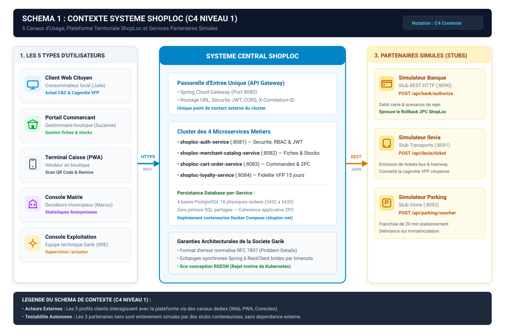
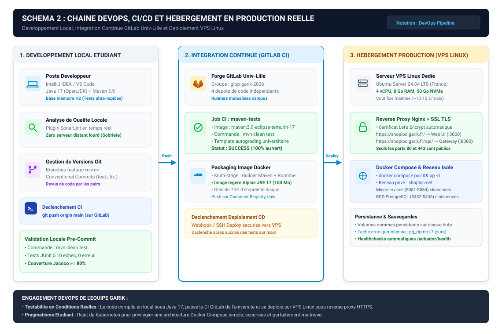

# DOSSIER D'ARCHITECTURE TECHNIQUE & STRATEGIE DE DEPLOIEMENT (LIVRABLE R2)

**Plateforme ShopLoc — Commerce de Proximite et Fidelite Territoriale**  
**Societe Garik**  
**Genie Logiciel par la Pratique (GLOP) / Architecture ALOM**  
**Enseignant Responsable : Jeremy Woirhaye**  
**Date de Remise : 19 octobre 2026**  

---

## Sommaire

1. **Pilier 1 : Architecture Distribuee des Microservices**
   * 1.1 Decoupage en microservices metiers et frontieres de donnees
   * 1.2 Flux d'echanges, passerelle unique et simulateurs de partenaires
   * 1.3 Coherence transactionnelle distribuee (Two-Phase Commit applicatif)
   * 1.4 Maitrise des couts, des risques et de l'observabilite
   * 1.5 Cartographie architecturale du systeme distribue (Schema 1)
   * 1.6 Justification de l'outil de schematisation
2. **Pilier 2 : Chaine d'Ingenierie Logicielle et Choix des Outils**
   * 2.1 Gestion du code et integration continue (GitLab & GitLab CI)
   * 2.2 Outil de build et standardisation (Apache Maven)
   * 2.3 Stack logicielle applicative (Spring Boot, PostgreSQL, React)
   * 2.4 Assurance qualite et couverture de tests (JUnit 5, Jacoco, SonarLint)
   * 2.5 Pilotage agile du backlog (Linear)
   * 2.6 Cartographie de la chaine DevOps et de livraison (Schema 2)
   * 2.7 Validation operationnelle de bout en bout (Walking Skeleton)
3. **Pilier 3 : Hebergement, Deploiement et Exploitation en Production Reelle**
   * 3.1 Cible d'hebergement souveraine : Choix et justification du VPS Linux OVHcloud
   * 3.2 Exposition publique et terminaison securisee : Reverse Proxy Nginx et HTTPS Let's Encrypt
   * 3.3 Parcours utilisateur concret : Du navigateur client jusqu'aux microservices
   * 3.4 Orchestration conteneurisee et cloisonnement reseau Docker Compose
   * 3.5 Procedure de deploiement continu (CD) et mise a jour applicative
   * 3.6 Plan de maintenance operationnelle, sauvegardes automatiques et supervision
4. **Pilier 4 : Gouvernance d'Equipe, Usage de l'IA et Eco-Conception**
   * 4.1 Repartition des responsabilites techniques au sein de la Societe Garik
   * 4.2 Cadre d'utilisation methodologique de l'intelligence artificielle
   * 4.3 Engagements transversaux d'eco-conception numerique (RGESN)

---

## 1. Pilier 1 : Architecture Distribuee des Microservices

La plateforme ShopLoc repond a un objectif d'animation du commerce de centre-ville a travers une architecture distribuee evolutive. La Societe Garik a retenu une organisation en microservices autonomes garantissant la stabilite des services, l'independance des cycles de vie logiciels et l'isolation stricte des donnees.

### 1.1. Decoupage en Microservices Metiers et Frontieres de Donnees

Le systeme est decompose en quatre services metiers distincts, chacun operant sur un domaine fonctionnel clos et appliquant le principe fondamental Database-per-Service. Aucune base de donnees n'est partagee entre services :

* **Service d'Authentification (`shoploc-auth-service` - Port 8081)** :  
  Ce service est l'autorite de securite de la plateforme. Il administre les comptes utilisateurs, le controle d'acces base sur les roles RBAC (`CITOYEN`, `COMMERCANT`, `MAIRIE`), et assure le hachage cryptographique des mots de passe avec BCrypt. Il genere et valide les jetons porteurs signes JWT (JSON Web Tokens).  
  *Donnees isolees (`auth_db` sur port 5432)* : Comptes utilisateurs, identifiants de connexion, hashs de mots de passe, associations de roles et jetons de rafraichissement.
* **Service Catalogue & Commercants (`shoploc-merchant-catalog-service` - Port 8082)** :  
  Ce service maintient le referentiel des commerces de proximite affilies, leurs fiches descriptives, leurs horaires d'ouverture et l'ensemble de leur catalogue de produits. Il est responsable de la tenue des stocks en temps reel et de la reservation temporaire d'articles.  
  *Donnees isolees (`catalog_db` sur port 5433)* : Boutiques partenaires, categories, fiches produits, prix, quantites physiques disponibles et verrous de reservation temporaires.
* **Service Panier & Commandes (`shoploc-cart-order-service` - Port 8083)** :  
  Ce service administre le panier d'achat Click & Collect multi-commerces et orchestre la transformation d'un panier en commande validee. Il agit en tant que coordinateur transactionnel pour reserver les articles aupres des differents marchands avant validation.  
  *Donnees isolees (`order_db` sur port 5434)* : Lignes de panier, commandes globales, sous-commandes detaillees par commercant, statuts de reglement et codes de retrait.
* **Service Fidelite Territoriale (`shoploc-loyalty-service` - Port 8084)** :  
  Ce service opere le moteur de dynamisation commerciale VFP (*Vente Flash Proximite*). Il calcule les points de fidelite credites lors des achats, gere leur validite a 15 jours glissants via un traitement planifie nocturne, genere les QR codes de retrait citoyens et traite la conversion des cagnottes en avantages locaux (tickets de transport ou stationnement).  
  *Donnees isolees (`loyalty_db` sur port 5435)* : Soldes de points citoyens, lots d'acquisition dates, historique de cagnottage et titres municipaux delivres.

---

### 1.2. Flux d'Echanges, Passerelle Unique et Simulateurs de Partenaires

L'exposition et la communication des services reposent sur trois principes directeurs :
1. **Passerelle d'Entree Unique (*API Gateway*)** :  
   Les interfaces utilisateur (web et mobile) ne communiquent jamais directement avec les microservices. Toutes les requetes passent par `shoploc-api-gateway` (Spring Cloud Gateway sur le port 8080). Cette passerelle centralise le routage des URL vers les services cibles, verifie la signature des jetons JWT a la frontiere du reseau prive, et autorise de maniere uniforme les origines front-end autorisees via CORS.
2. **Echanges Inter-Services Synchrones (HTTP REST)** :  
   Pour les operations transactionnelles requerant une reponse immediate a l'utilisateur (comme la verification de stock lors de la validation du panier), les microservices s'interpellent directement en HTTP synchrone via Spring 6 RestClient. Chaque client d'appel est bride par des timeouts stricts (1 seconde de connexion, 2 secondes de lecture) et retourne des structures d'erreurs normalisees conformes a la RFC 7807 (Problem Details).
3. **Simulateurs de Services Partenaires (Stubs REST)** :  
   Pour garantir la testabilite permanente de la solution sans dependre de services tiers externes payants ou indisponibles, trois simulateurs HTTP autonomes reproduisent fidelement les reponses attendues :
   * *Simulateur Bancaire (Port 8090)* : Valide ou rejette les autorisations de paiement selon le numero de carte utilise.
   * *Simulateur Transports Ilevia (Port 8091)* : Emet des titres virtuels de bus et de tramway lors de l'echange de points.
   * *Simulateur Voirie & Parking (Port 8092)* : Genere des codes de franchise de stationnement municipal.

---

### 1.3. Coherence Transactionnelle Distribuee (Two-Phase Commit Applicatif)

L'independance physique des bases de donnees interdit l'usage d'une transaction SQL commune pour une commande regroupant des articles de plusieurs commerces. La Societe Garik a mis en oeuvre un mecanisme applicatif de Two-Phase Commit (2PC) pilote par le service commande :
* **Phase 1 (Preparation / PREPARE)** : Le service commande transmet a chaque service catalogue concerne une demande de reservation pour les quantites demandees. Le catalogue verifie le stock physique disponible et enregistre une reservation avec le statut PENDING, horodatee avec une validite maximale de 5 minutes.
* **Phase 2 (Confirmation / COMMIT)** : Si tous les commercants repondent favorablement, le service commande debite le reglement simule, transmet l'ordre definitif de validation (les articles reserves passent a l'etat valide et sont definitivement deduits de l'inventaire physique), puis notifie le service fidelite pour crediter le citoyen.
* **Phase de Compensation (ROLLBACK)** : Si l'un des commercants signale un stock insuffisant ou si une requete echoue par depassement de timeout (2 secondes), le coordinateur annule immediatement la transaction, ordonne la liberation des reservations PENDING chez les marchands precedemment sollicites, et retourne un message d'erreur explicite au client sans debiter son compte.

---

### 1.4. Maitrise des Couts, des Risques et de l'Observabilite

L'adoption d'une architecture distribuee engendre des defis que notre equipe maitrise par des choix de conception rigoureux :
* **Complexite operationnelle** : L'execution de multiples services est simplifiee grace a Docker Compose, qui unifie le demarrage de tous les conteneurs et de leurs reseaux internes en un seul point de controle.
* **Risque de defaillance en cascade** : L'isolation derriere la passerelle garantit que la panne temporaire d'un service (par exemple la fidelite) n'empeche pas le fonctionnement des autres fonctionnalites critiques (consultation du catalogue et achat Click & Collect).
* **Tragabilite distribuee** : Un identifiant de correlation unique (`X-Correlation-ID`) est injecte par la Gateway au debut de chaque requete et propage a travers tous les appels inter-services, permettant de reconstituer l'historique d'une transaction complete a travers les flux de journalisation.

---

### 1.5. Cartographie Architecturale du Systeme Distribue (Schema 1)

Le schema ci-apres synthetise la disposition globale des acteurs, des canaux d'acces, de la passerelle Gateway, des microservices metiers, de leurs bases de donnees dediees et des simulateurs partenaires.

---

### 1.6. Justification de l'Outil de Schematisation

La Societe Garik a choisi le format vectoriel SVG genere par script pour produire ses livrables graphiques. Contrairement aux outils proprietaires a format binaire ou XML complexe (Draw.io), les fichiers SVG generes par code s'integrent naturellement dans le suivi de version Git sans provoquer de conflit de fusion. De plus, ils garantissent une resolution graphique parfaite a tout niveau de zoom sur les rendus PDF, tout en presentant une empreinte de stockage extremement sobre (~25 Ko par schema).

---

## 2. Pilier 2 : Chaine d'Ingenierie Logicielle et Choix des Outils

Le choix de l'outillage logiciel de la plateforme ShopLoc repose sur une grille d'analyse comparant chaque composant selectionne a deux ou trois solutions concurrentes, selon six criteres : C1 (Cout et licence), C2 (Facilite de prise en main), C3 (Integration globale), C4 (Hebergement et conformite RGPD), C5 (Eco-conception logicielle) et C6 (Adaptation a l'architecture microservices).

### 2.1. Gestion du Code et Integration Continue (GitLab & GitLab CI)
* **Choix retenu : GitLab Institutionnel (Groupe `glop-garik-2026`)**  
  *Justification* : Hebergement souverain en France garantissant une conformite immediate avec le RGPD, integration native avec les runners CI de l'infrastructure d'evaluation, et absence totale de facturation additionnelle sur les depots prives. Les alternatives GitHub et Bitbucket ont ete ecartees pour leurs quotas de calcul limites et l'hebergement de leurs donnees sous juridiction americaine (Cloud Act).  
  *Lien du groupe d'exploitation* : [`https://gitlab.univ-lille.fr/groups/glop-garik-2026`](https://gitlab.univ-lille.fr/groups/glop-garik-2026).
* **Pipeline d'integration continue : GitLab CI**  
  *Justification* : Execution automatique a chaque push, liaison directe avec le modele d'autograding enseignant, et instanciation de conteneurs ephemeres detruits apres execution, garantissant une empreinte carbone minimale. Jenkins a ete refuse en raison de la lourdeur d'administration d'un serveur permanent dedie.

---

### 2.2. Outil de Build et Standardisation (Apache Maven)
* **Choix retenu : Apache Maven 3.9**  
  *Justification* : Standard industriel rigoureusement structure, cycle de vie predictible, disponibilite des plugins officiels Spring Boot 3.3.4 et Jacoco, et gestion de configuration independante via un fichier descriptif par microservice. Gradle a ete ecarte en raison de la complexite accrue de ses scripts Groovy et de la consommation d'un demon resident monopolisant de la memoire vive.

---

### 2.3. Stack Logicielle Applicative
* **Backend : Java 17 et Spring Boot 3.3.4**  
  *Justification* : Typage statique robuste indispensable aux architectures distribuées, support complet des objets de transfert immutables avec les records Java 17, validation declarative Jakarta, format d'erreur normalise RFC 7807 et integration native du client HTTP RestClient. Node.js et Python ont ete ecartes car moins rigides sur les patrons de transactions distribuees.
* **Base de donnees : PostgreSQL 16 (Database-per-Service)**  
  *Justification* : Fiabilite absolue des transactions relationnelles ACID indispensable pour la gestion des stocks marchands et des paiements, support avance des types JSONB et maturite du moteur SQL. MongoDB a ete refuse car l'absence de contraintes relationnelles fortes fragilise la coherence financiere Click & Collect.
* **Frontend : React 18, TypeScript et Vite**  
  *Justification* : Decoupage en composants modulaires, typage statique aligne sur les DTOs backend prevenant les erreurs d'incompatibilite d'API, et optimisation du bundle de production via Vite produisant des fichiers statiques ultra-legers (~180 Ko). Angular a ete juge trop complexe pour notre front-end.

---

### 2.4. Assurance Qualite et Couverture de Tests (JUnit 5, Jacoco, SonarLint)
* **Tests unitaires et d'integration : JUnit 5, AssertJ et Mockito**  
  *Justification* : Standard unifie de Spring Boot permettant de tester la logique metier en isolant parfaitement les composants par des doublures de test (mocks).
* **Couverture de code : Plugin Jacoco (Seuil minimal >= 80%)**  
  *Justification* : Generation de rapports quantitatifs automatises integres a chaque build Maven pour verifier le seuil d'acceptation qualite.
* **Analyse statique : Plugin SonarLint**  
  *Justification* : Verification des regles Clean Code directement integree aux postes de developpement en temps reel, eliminant le besoin d'heberger un serveur lourd SonarQube.

---

### 2.5. Pilotage Agile du Backlog (Linear)
* **Choix retenu : Linear (`https://linear.app/projet-glop`)**  
  *Justification* : Rapidite de chargement, gestion d'effort selon les standards INVEST en cycles de deux semaines, et references directes de tickets dans les messages de commit Git. Jira a ete ecarte pour sa lourdeur d'interface.

---

### 2.6. Cartographie de la Chaine DevOps et de Livraison (Schema 2)

Le schema suivant represente la continuite des etapes d'ingenierie logicielle, depuis la phase de developpement local jusqu'a la mise a disposition sur le serveur de production.

---

### 2.7. Validation Operationnelle de Bout en Bout (Walking Skeleton)

Pour valider l'efficacite de la chaine d'outillage, la Societe Garik a deploye et valide un premier jalon logiciel fonctionnel reliant deux microservices :
* Le service catalogue expose ses articles via un endpoint REST et persiste ses fiches produits sous Spring Data JPA.
* Le service commande interroge le catalogue a distance via Spring 6 RestClient pour verifier la presence d'un article avant ajout au panier.
* La suite de tests unitaires et d'integration inter-services s'execute sans aucune anomalie sur les runners d'integration continue de l'universite, attestant d'une couverture Jacoco validee et de pipelines de tests 100% au vert sur les microservices concernes.

---

## 3. Pilier 3 : Hebergement, Deploiement et Exploitation en Production Reelle

Une architecture logicielle ne produit de valeur que lorsqu'elle est reellement deployable et accessible dans des conditions de production. La Societe Garik a concu une strategie d'hebergement complete, souveraine et hautement securisee.

### 3.1. Cible d'Hebergement Souveraine : Choix et Justification du VPS Linux OVHcloud

L'equipe Garik a selectionne un serveur **VPS (Virtual Private Server) Linux** heberge par le fournisseur souverain francais **OVHcloud** (ou alternativement une VM universitaire dediee), configure sous **Ubuntu Server 24.04 LTS** :
* **Pourquoi OVHcloud plutot qu'un fournisseur hyperscaler (AWS, Azure, GCP)** :  
  1. *Transparence financiere et couts forfaitaires* : Un serveur VPS OVHcloud fonctionne sur un abonnement fixe mensuel d'environ 10 a 15 € par mois (ou sans surcout en environnement universitaire). A l'inverse, les plateformes comme AWS ou Google Cloud reposent sur une facturation a la consommation dynamique (heures d'instance, trafic reseau sortant, requetes de stockage) qui presente un risque majeur de derive financiere pour notre structure.
  2. *Souverainete des donnees et conformite RGPD* : Les centres de donnees d'OVHcloud utilises sont physiquement localises en France (Roubaix et Gravelines). Les donnees des commercants et citoyens ne traversent aucune frontiere extracommunautaire et restent a l'abri des legislations extraterritoriales etrangeres comme le Cloud Act.
  3. *Performance reseau et proximite territoriale* : La proximite geographique de l'infrastructure garantit des temps de latence minimaux pour les usagers et commercants de la metropole lilloise.
* **Pourquoi un serveur VPS plutot qu'un serveur dedie physique ou du Serverless** :  
  Le VPS offre un ratio cout-performance optimal (4 coeurs vCPU, 8 Go de memoire vive RAM et 50 Go de disque SSD NVMe). Il assure une isolation complete du systeme d'exploitation sans supporter les couts materiels eleves d'un serveur physique dedie.

---

### 3.2. Exposition Publique et Terminaison Securisee : Reverse Proxy Nginx et HTTPS Let's Encrypt

Pour securiser les acces et eviter d'exposer nos composants applicatifs directement sur Internet, nous integrons un **Reverse Proxy Nginx** en frontal :
* **Role et fonctionnement de Nginx** :  
  Nginx est l'unique service du serveur a ecouter sur les ports reseau publics 80 (HTTP) et 443 (HTTPS). Son role est de recevoir l'ensemble des requetes externes, de gerer le protocole de chiffrement TLS, et d'acheminer le trafic en local vers les conteneurs applicatifs selon la route demandee :
  * Les requetes adressees a l'interface web sont transmises au conteneur React (`shoploc-web-ui` sur le port interne 3000).
  * Les requetes adressees aux API de donnees (`/api/**`) sont redirigees vers la passerelle (`shoploc-api-gateway` sur le port interne 8080).
  * *Cloisonnement de securite* : Tous les autres ports applicatifs (8081 a 8084) et les ports des bases de donnees PostgreSQL (5432 a 5435) sont totalement fermes au reseau exterieur. Ils sont inaccessibles depuis Internet et ne communiquent qu'a l'interieur du reseau prive Docker.
* **Chiffrement SSL/TLS Automatique avec Let's Encrypt** :  
  L'application est rendue accessible sous une adresse securisee HTTPS (`https://shoploc.garik.fr`). Le certificat cryptographique officiel est delivre gratuitement par l'autorite de certification ouverte Let's Encrypt via l'utilitaire **Certbot**.
  * Certbot verifie la propriete du nom de domaine, genere la cle privee et le certificat X.509, et configure Nginx pour forcer la redirection automatique de tout le trafic HTTP non securise vers le protocole HTTPS chiffre.
  * Les certificats Let's Encrypt etant valables 90 jours, une tache planifiee systeme (`cron`) declenche automatiquement une verification et un renouvellement bimensuel sans aucune interruption de service.

---

### 3.3. Parcours Utilisateur Concret : Du Navigateur Client jusqu'aux Microservices

Voici le cheminement precis d'une operation d'achat realisee par un citoyen sur la plateforme en production :
1. **Accès au portail** : L'utilisateur saisit `https://shoploc.garik.fr` dans son navigateur.
2. **Prise en charge par Nginx** : La requete atteint le serveur VPS sur le port 443. Nginx valide le certificat SSL Let's Encrypt et retourne les fichiers de l'application cliente React 18 servie par le conteneur front-end.
3. **Appel d'API securise** : Lors de la validation de son panier Click & Collect, l'interface web emet un appel HTTP `POST` a destination de `https://shoploc.garik.fr/api/v1/orders/checkout` avec le jeton Bearer JWT de l'utilisateur.
4. **Filtrage par la Gateway** : Nginx transmet l'appel au conteneur `shoploc-api-gateway` sur le reseau interne prive `shoploc-net`. La passerelle controle la validite du jeton JWT, verifie les autorisations et retransmet la charge utile au microservice de commande (`shoploc-cart-order-service` sur le port interne 8083).
5. **Coordination 2PC** : Le service commande contacte le service catalogue (`shoploc-merchant-catalog-service` :8082) pour reserver le stock en base `catalog_db`, debite le montant via le stub bancaire, valide la commande dans `order_db`, et sollicite le service fidelite (`shoploc-loyalty-service` :8084) pour ajouter les points dans `loyalty_db`.
6. **Confirmation finale** : La commande est confirmee et Nginx renvoie la reponse de confirmation chiffree en HTTPS au navigateur du client en quelques fractions de seconde.

---

### 3.4. Orchestration Conteneurisee et Cloisonnement Reseau Docker Compose

L'integralite de la plateforme en production est decrite dans un fichier déclaratif `docker-compose.prod.yml` :
* **Reseau prive etanche (`shoploc-net`)** : Les conteneurs communiquent entre eux en utilisant leur nom de service comme nom d'hote DNS interne. Aucun conteneur de microservice ou de base de donnees n'expose ses ports sur l'adresse IP publique de la machine.
* **Volumes de donnees persistants** : Les repertoires de donnees de PostgreSQL sont montes sur des volumes persistants sur l'hote (`auth_data`, `catalog_data`, `order_data`, `loyalty_data`). Un arret ou une mise a jour d'un conteneur n'affecte en aucun cas l'integrite physique des bases de donnees.

---

### 3.5. Procedure de Deploiement Continu (CD) et Mise a Jour Applicative

Pour appliquer les evolutions logicielles sans complexite manuelle, l'equipe a defini une chaine de deploiement en continu :
1. Lorsqu'une modification de code est validee et fusionnee sur la branche principale `main` de GitLab, le pipeline CI compile les sources, execute la suite de tests unitaires et produit une image Docker multi-stage compacte (Alpine JRE 17 de 150 Mo).
2. L'image de production est estampillee et publiee automatiquement sur le registre prive de l'universite (`registry.gitlab.univ-lille.fr/glop-garik-2026/`).
3. Le deploiement sur le serveur VPS est effectue via une cle d'acces SSH restreinte ou un script de depeche qui execute successivement :
   * La recuperation des dernieres versions des conteneurs (`docker compose pull`).
   * Le redemarrage sans coupure des services mis a jour (`docker compose up -d --remove-orphans`).
4. Une verification de disponibilite immediate (Smoke Test) interroge l'endpoint `/api/actuator/health` pour certifier que l'ensemble des liaisons aux bases de donnees sont operationnelles.

---

### 3.6. Plan de Maintenance Operationnelle, Sauvegardes Automatiques et Supervision

L'exploitation durable de ShopLoc s'appuie sur trois dispositifs de maintenance :
* **Sauvegardes automatiques quotidiennes des bases de donnees** :  
  Une tache planifiee `cron` s'execute chaque nuit a 02h00 sur le serveur VPS. Elle lance un script effectuant un export logique complet (`pg_dump`) de chacune des quatre bases PostgreSQL. Ces archives SQL sont compressees au format `.tar.gz`, datees et stockees dans un repertoire dedie securise `/backups/shoploc/`, avec une politique de retention glissante preservant les 7 derniers jours d'historique.
* **Supervision de sante en continu** :  
  Les composants Spring Boot exposent nativement des metriques de bon fonctionnement via Spring Boot Actuator (`/actuator/health`). L'etat des connexions relationnelles, la disponibilite de la memoire vive et l'espace disque restant sont surveilles en permanence.
* **Diagnostic et consultation des flux de journalisation** :  
  Pour diagnostiquer d'eventuelles anomalies en production sans requerir un acces administrateur direct sur la machine, l'equipe exploite les flux de journalisation Docker centralises consultables a distance via l'utilitaire securise Dozzle, accessible sous controle d'acces restreint.

---

## 4. Pilier 4 : Gouvernance d'Equipe, Usage de l'IA et Eco-Conception

### 4.1. Repartition des Responsabilites Techniques au Sein de la Societe Garik

Pour assurer un pilotage clair et sans ambiguite, chaque domaine d'ingenierie est place sous la responsabilite directe d'un membre de la Societe Garik :

| Role de Gouvernance | Responsable Titulaire | Perimetre d'Attribution & Engagements |
| :--- | :--- | :--- |
| **Responsable Deploiement & Qualite Globale** | **Khalil Bouchama** | Orchestration Docker Compose, deploiement du VPS Linux, reverse proxy Nginx TLS, supervision Actuator et respect du seuil de couverture Jacoco >= 80%. |
| **Specialiste Outils & Forge** | **Rayane Alli** | Administration de la forge GitLab, gestion des runners CI, protection des branches, conventions de commits et suivi de l'espace Linear. |
| **Responsable Architecture Back-End** | **Abdelkader Heddi** | Conception et modularisation des microservices Spring Boot 3.3, coordinateur Two-Phase Commit (2PC) et standardisation des echanges RestClient. |
| **Responsable Donnees, Persistance & Securite** | **Gautam Demeulemeester** | Modelisation des 4 bases PostgreSQL 16 (Database-per-Service 3NF), securite JWT/BCrypt et politique de sauvegardes nocturnes cron. |
| **Responsable Front-End & Accessibilite** | **Ilyas Ait ali** | Application cliente React 18 sous Vite, agencement stylistique Tailwind CSS et garantie d'accessibilite numerique aux standards RGAA AA. |

*Rotation du role de Scrum Master* : La coordination agile des sprints bi-hebdomadaires fait l'objet d'un roulement methodique entre les membres de l'equipe Garik (Sprint 1 : Khalil -> Sprint 2 : Abdelkader -> Sprint 3 : Rayane -> Sprint 4 : Gautam -> Sprint 5 : Ilyas).

---

### 4.2. Cadre d'Utilisation Methodologique de l'Intelligence Artificielle

La Societe Garik integre l'assistance algorithmique de modeles de langage dans un cadre professionnel transparent :

| Domaine Technique | Usage de l'IA | Finalite Operationnelle & Justification |
| :--- | :---: | :--- |
| **Gestion du code (Git)** | **Non** | La topologie des depots, branches et Merge Requests releve de la decision humaine exclusive. |
| **Outil de build (Maven)** | **Oui** | Syntaxe initiale des plugins Maven (Jacoco et packaging de production Spring Boot). |
| **Backend (Spring Boot)** | **Oui** | Generation rapide des structures de classes DTOs immutables (records) et handlers d'erreur RFC 7807. |
| **Persistance (PostgreSQL)** | **Non** | Conception relationnelle 3NF et requetes SQL elaborees integralement a la main. |
| **Frontend (React)** | **Oui** | Suggestions d'agencement CSS pour valider les ratios de contraste de l'accessibilite RGAA. |
| **CI/CD (GitLab)** | **Oui** | Validation de la syntaxe declarative du pipeline `.gitlab-ci.yml`. |
| **Conteneurs (Docker)** | **Oui** | Squelette de separation multi-stage dans le Dockerfile. |
| **Tests (JUnit 5)** | **Oui** | Proposition de cas aux limites pour enrichir les assertions de tests unitaires. |
| **Supervision (Actuator)** | **Non** | Composant natif de l'ecosysteme Spring utilise sans assistance externe. |
| **Gestion agile (Linear)** | **Non** | Redaction humaine exclusive des User Stories et de leurs criteres d'acceptation. |

* **Apports constates** : Gain de productivite sur le code boilerplate repetitif et structuration comparative des grilles d'outils.
* **Limites et arbitrages** : Les modeles ont regulierement propose des approches disproportionnees (clusters Kubernetes, Kafka) ou des bibliotheques obsoletes (Spring WebClient). L'equipe a systematiquement corrige ces propositions pour garantir la sobriete et la conformite de notre architecture.
* **Engagement de maitrise et confidentialite** : Aucun secret technique ni donnees personnelles n'ont ete transmis a un service tiers. 100% des lignes de code et de configuration sont integralement comprises et explicables par chaque membre de l'equipe.

---

### 4.3. Engagements Transversaux d'Eco-Conception Numerique (RGESN)

En accord avec le Referentiel General d'Eco-conception de Services Numeriques, la Societe Garik applique quatre regles de sobriete fondamentales :
1. **Rejet de Kubernetes au profit de Docker Compose** : Economie permanente de plus de 3 Go de memoire vive et de cycles CPU dedies a un plan de controle disproportionne.
2. **Images d'execution allegees (Alpine JRE 150 Mo)** : Reduction de 75% du volume des images conteneurisees par rapport a un environnement de developpement classique.
3. **Sobriete des echanges REST** : Pagination stricte des requetes de recherche catalogue, minimisant la charge reseau utile.
4. **Distribution front-end epuree** : Application React 18 compilee sous forme de fichiers statiques legers, servie avec un temps de chargement initial negligeable.
