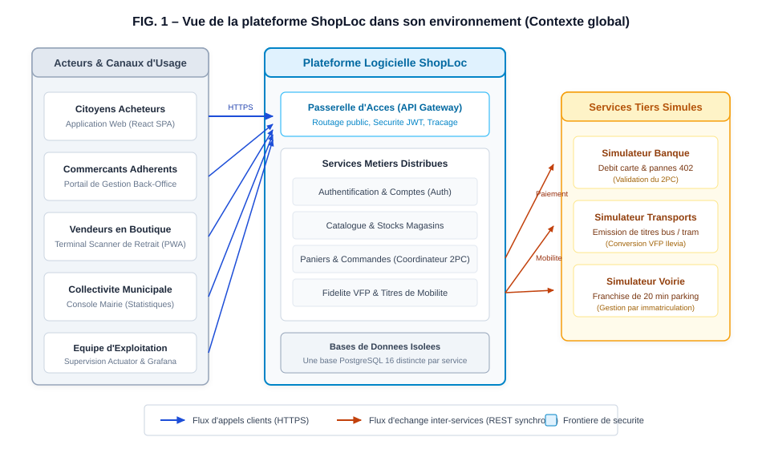
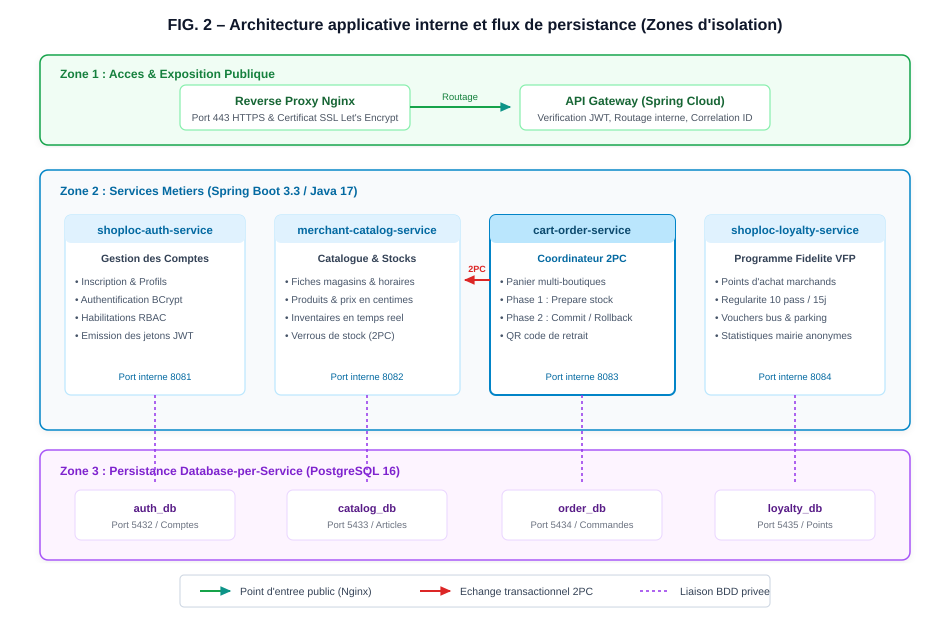
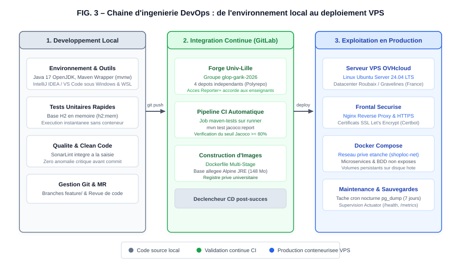
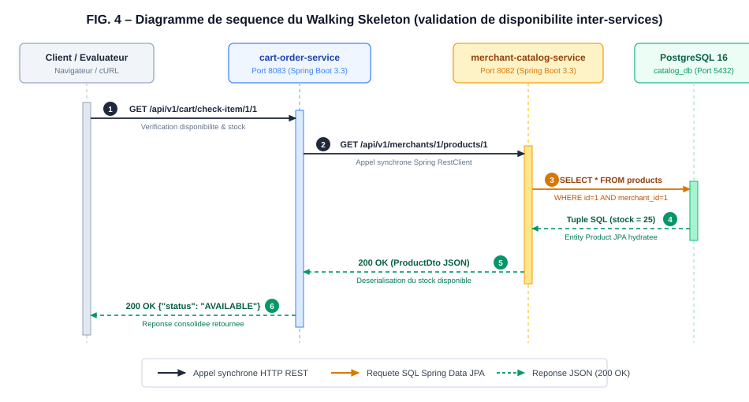

# 1. Vue d'ensemble du systeme et contexte

## 1.1. Contexte du projet et objectifs

La plateforme ShopLoc est concue par la Societe Garik dans le cadre de l'UE Genie Logiciel par la Pratique (GLOP 2026-2027) de l'Universite de Lille. Elle repond a l'imperatif de revitalisation economique du commerce de proximite en coeur de ville en federant les commerces independants au sein d'une place de marche locale unifiee.

Le projet permet aux citoyens de commander aupres de multiples commerces locaux via un panier unique en Click & Collect, tout en valorisant la fidelite territoriale et les mobilites douces par l'octroi d'avantages concrets comme des titres de transport Ilévia ou des franchises de stationnement.

Pour garantir l'autonomie de deploiement, la resilience face aux pannes et l'isolation stricte des donnees marchandes, le socle technique s'appuie sur une architecture distribuee en microservices conteneurises conformes aux standards de l'artisanat logiciel.

## 1.2. Acteurs et interfaces externes

Le systeme interagit avec cinq profils d'utilisateurs et trois simulateurs de services tiers :
- **Citoyens acheteurs** : Consultation du catalogue multi-boutiques et passation de commande sur l'application web responsive.
- **Commercants adherents** : Administration des etablissements, des fiches articles et des inventaires en temps reel via le portail de gestion.
- **Vendeurs en boutique** : Validation immediate des retraits en caisse au moyen d'un terminal leger (PWA avec scan de QR code).
- **Collectivite municipale** : Consultation des indicateurs de dynamisme commercial et d'usage des mobilites via la console de bord elus.
- **Equipe d'exploitation** : Supervision de l'etat des conteneurs, des sondes de sante et des metriques operationnelles.
- **Simulateurs partenaires** : Validation des autorisations et refus de paiement bancaire, emission de titres de transport urbain et allocation de franchises voirie.

## 1.3. Cartographie globale du systeme

La figure ci-apres synthetise la disposition generale des acteurs, des interfaces applicatives et des frontieres avec les services tiers simules :

  
  
FIG. 1 – Vue de la plateforme ShopLoc dans son environnement (Contexte global)

# 2. Architecture applicative des microservices

## 2.1. Decoupage en services metiers et responsabilités

L'architecture applicative retient un decoupage en quatre microservices autonomes dotes de perimetres metiers stricts :
- **Authentification (`shoploc-auth-service`, port 8081)** : Gestion centralisee des identites, hachage securise des mots de passe (BCrypt), habilitations selon le modele RBAC (citoyen, commercant, mairie) et emission des jetons JWT signes.
- **Catalogue & Marchands (`shoploc-merchant-catalog-service`, port 8082)** : Referentiel des etablissements, fiches articles, tarifs unitaires et inventaire des stocks disponibles avec pose de verrous temporaires.
- **Panier & Commandes (`shoploc-cart-order-service`, port 8083)** : Coeur transactionnel orchestrant le panier multi-boutiques, coordination du protocole 2PC, echanges avec le simulateur bancaire et generation du QR code de retrait.
- **Fidelite Territoriale (`shoploc-loyalty-service`, port 8084)** : Comptabilisation des points d'achat, calcul de la regularite de passage commercant (statut VFP), conversion en titres de transport ou stationnement et agregats statistiques anonymes.

## 2.2. Justification architecturale : microservices versus monolithe

Le choix d'une architecture orientee microservices repond a quatre criteres d'ingenierie evalues au regard des contraintes fonctionnelles et financieres :
- **Autonomie des cycles de developpement** : Le catalogue et la fidelite evoluent a des rythmes distincts. Le decoupage permet aux binomes de developper, tester et deployer sans friction ni conflit de fusion de code.
- **Isolation des defaillances et resilience** : Dans un monolithe, un blocage memoire lors du calcul des fidelites paralyserait toute l'application. En microservices, l'indisponibilite d'un tiers n'interrompt ni la consultation des articles ni l'authentification.
- **Dimensionnement et efficience des ressources** : Les pics de consultation sur le catalogue aux heures de pointe sont absorbes par la duplication ciblee des conteneurs les plus sollicites, sans surallouer les modules administratifs.
- **Maitrise des couts et de la complexite repartie** : La complexite transactionnelle est maitrisee en limitant le perimetre a quatre microservices clairs relies par le protocole Two-Phase Commit.

## 2.3. Arbitrage des flux : communication synchrone REST versus asynchrone

L'arbitrage entre communication synchrone et asynchrone a ete evalue selon les besoins fonctionnels et l'empreinte materielle. L'adoption d'un bus de messages asynchrone (type Apache Kafka ou RabbitMQ) aurait alourdi la consommation memoire d'au moins 1,5 Go de RAM sur le serveur VPS. L'usage de flux HTTP/REST directs garantit une empreinte minimale compatible avec l'hebergement sobre chez OVHcloud.

Ce choix repond a l'exigence d'immediatete transactionnelle du parcours Click & Collect lors de la reservation du panier. Pour maitriser le risque de blocage en cascade entre services, des delais d'expiration stricts (timeouts de 2 secondes) et des politiques de disjoncteurs sont configures au niveau des clients Spring `RestClient`.

## 2.4. Passerelle d'API et communication inter-services

L'ensemble des communications s'organise autour d'un point d'acces centralise et de flux inter-composants homogenes :
- **Passerelle d'API (API Gateway)** : Point d'entree unique masquant le reseau interne prive, verifiant les jetons JWT, filtrant les regles CORS et injectant un identifiant de correlation (`X-Correlation-ID`) sur chaque requete entrante.
- **Appels synchrones REST** : Protocole HTTP sous formalisme JSON avec application stricte de la norme RFC 7807 (Problem Details) pour la remontee des exceptions techniques et metiers.
- **Protection reseau** : Reseau Docker prive `shoploc-net` isolant les microservices du trafic internet public, seul le port HTTPS du reverse proxy Nginx etant expose.

## 2.5. Gestion et coherence des donnees : Le protocole Two-Phase Commit (2PC)

Afin d'eviter tout couplage au niveau de la persistance, ShopLoc applique le patron Database-per-Service. Chaque composant dispose d'une base relationnelle PostgreSQL 16 dediee (`auth_db`, `catalog_db`, `order_db`, `loyalty_db`), interdisant tout acces direct inter-bases.

Pour garantir la coherence des reservations de stocks lors d'une commande multi-boutiques, le service de commande pilote un protocole 2PC adapte au protocole REST :
1. **Phase de preparation (Prepare)** : Le coordinateur demande a chaque boutique de reserver les quantites voulues. Le service catalogue pose un verrou transactionnel d'une duree de validite de 5 minutes.
2. **Phase de confirmation (Commit)** : A reception de l'accord du simulateur bancaire, le coordinateur valide la commande. Les stocks physiques sont decrementes et les points de fidelite sont credites.
3. **Phase de compensation (Rollback)** : En cas d'echec bancaire ou d'indisponibilite d'un article, un ordre d'annulation est diffuse a tous les catalogues pour lever les verrous sans prelevement citoyen.

## 2.6. Cartographie applicative et flux de donnees

La figure ci-apres illustre la repartition en trois zones d'isolation (exposition publique, logique metier, persistance relationnelle) ainsi que les interactions d'orchestration :

  
  
FIG. 2 – Architecture applicative interne et flux de persistance (Zones d'isolation)

# 3. Choix et justification des outils

Conformement aux exigences de cadrage, l'outillage logiciel a ete selectionne selon une demarche rigoureuse confrontant chaque solution retenue a deux alternatives reconnues.

## 3.1. Gestion du code source et industrialisation du build

Pour la gestion des sources, l'equipe a retenu la forge institutionnelle GitLab de l'Universite de Lille sous organisation polyrepo (un depot par microservice et un depot d'orchestration) sous le groupe officiel `glop-garik-2026`. Ce choix garantit la souverainete des donnees sur infrastructure academique, l'utilisation directe des runners CI de l'universite et un acces transparent pour les enseignants sans restriction de quotas, a l'inverse de GitHub Enterprise ou de la charge de maintenance d'une instance Gitea.

L'industrialisation du build repose sur Apache Maven 3.9 dote du wrapper autonome (`mvnw`). Standard universel de l'ecosysteme Spring Boot, Maven assure des builds deterministes et reproductibles sur tout poste sans prerequis d'installation. Il a ete prefere a Gradle pour sa clarte declarative et a Ant/Ivy desormais depasse pour la gestion des microservices.

## 3.2. Socle applicatif et conteneurisation

Le backend est developpe en Java 17 LTS sous le framework Spring Boot 3.3. Ce standard apporte la robustesse du typage statique, l'usage des `records` pour l'immutabilite des DTOs et une integration native des transactions SQL. Il a ete privilegie face a la lourdeur memoire de Jakarta EE sous WildFly (> 1 Go de RAM) et au manque de rigueur transactionnelle ACID de Node.js. L'interface web responsive repose sur React 18 avec TypeScript et le bundler Vite, generant un livrable statique leger (~180 Ko) conforme au referentiel d'accessibilite RGAA.

La conteneurisation est confiee a Docker via des fichiers Dockerfile multi-stage builds separant compilation et execution. L'orchestration par Docker Compose au sein du depot `shoploc-platform` permet un deploiement complet en une commande, evitant l'inutile complexite operationnelle de Kubernetes sur notre serveur VPS Linux OVHcloud.

## 3.3. Integration continue, qualite et pilotage agile

L'automatisation des tests est orchestree par GitLab CI. A chaque commit pousse sur la branche principale, un conteneur leger Alpine (`maven:3.9-eclipse-temurin-17-alpine`) valide la compilation des sources, execute les tests unitaires JUnit 5 et certifie le respect du seuil de couverture minimale de 80 % via JaCoCo.

La supervision operationnelle est assuree par Prometheus et Grafana en exploitant nativement les sondes Spring Boot Actuator (`/actuator/prometheus`) pour une consommation memoire sobre (< 100 Mo), evitant la lourdeur de la pile ELK. Le suivi agile est quant a lui gere sur Linear selon le decoupage INVEST et une rotation reguliere du role de Scrum Master.

## 3.4. Synthese comparative des choix d'outillage

Le tableau suivant resume les arbitrages d'outillage effectues par la Societe Garik en integrant les criteres de cout, de prise en main, de conformite RGPD et de sobriete technique :

| Categorie d'Outil | Solution Retenue | Alternatives Comparees | Justification Majeure du Choix |
| :--- | :--- | :--- | :--- |
| **Gestion de code** | GitLab Univ-Lille | GitHub, Gitea | Hebergement souverain, runners integres, acces direct enseignants |
| **Outil de build** | Apache Maven 3.9 | Gradle, Ant/Ivy | Standard Spring Boot, Maven Wrapper autonome, builds reproductibles |
| **Stack applicative** | Spring Boot 3.3 / Java 17 | Jakarta EE, Node.js | Robustesse du typage statique, DTOs immutables, verrous SQL fiables |
| **Bases de donnees** | PostgreSQL 16 (H2 tests) | MySQL, MongoDB | Isolation Database-per-Service, transactions ACID, rapidite H2 en CI |
| **Framework front** | React 18 / TypeScript | Vue.js, Angular | Composants modulaires, typage strict, conformite accessibilite RGAA |
| **Conteneurisation** | Docker & Compose | Kubernetes, Podman | Isolation legere, deploiement 1-clic, adaptation parfaite au VPS |
| **Integration continue** | GitLab CI | GitHub Actions, Jenkins | Declenchement automatique a chaque push, rapports JUnit et JaCoCo |
| **Tests & Qualite** | JUnit 5 & JaCoCo | TestNG, Cobertura | Couverture superieure a 80 %, injection de contrats REST mockes |
| **Supervision metier** | Grafana / Prometheus | Metabase, Kibana (ELK) | Faible empreinte (< 100 Mo), sondes Actuator natives sans agent lourd |
| **Gestion de projet** | Linear | Jira, Trello | Interface agile epuree, criteres INVEST, Scrum Master tournant |

## 3.5. Cartographie de la chaine d'outils DevOps

La figure ci-dessous detaille le cycle d'integration et de deploiement continu, depuis l'environnement de travail etudiant jusqu'a la production sur serveur VPS :

  
  
FIG. 3 – Chaine d'ingenierie DevOps : de l'environnement local au deploiement VPS

# 4. Validation operationnelle (Walking Skeleton)

## 4.1. Perimetre et cinématique du prototype de bout en bout

La validation du Walking Skeleton demontre le fonctionnement reel et conjoint de la chaine d'outils via une execution minimale de bout en bout reliant deux microservices et une base de donnees :
- **Service Catalogue (`shoploc-merchant-catalog-service`, port 8082)** : Persiste les fiches produits dans sa base PostgreSQL et expose l'endpoint REST `GET /api/v1/merchants/1/products/1`.
- **Service Commande (`shoploc-cart-order-service`, port 8083)** : Expose l'endpoint `GET /api/v1/cart/check-item/1/1` et sollicite le catalogue via Spring `RestClient` pour verifier le stock.

Le diagramme de sequence ci-apres detaille la cinematique des requetes, attestant de l'interoperabilite reseau et de la persistance effective :

  
  
FIG. 4 – Diagramme de sequence du Walking Skeleton (validation de disponibilite inter-services)

## 4.2. Procedure de deploiement et de recette locale

Afin de permettre l'evaluation autonome du prototype, l'orchestration complete est centralisee sur le depot dedie `shoploc-platform` :
1. **Rapatriement des sources** : Clonage de `shoploc-platform` et execution du script `clone-all.sh` (Linux/Mac) ou `clone-all.bat` (Windows) pour recuperer l'ensemble des microservices.
2. **Demarrage des conteneurs** : Execution de `docker compose up -d` a la racine. Le reseau `shoploc-net` et le serveur PostgreSQL sont instancies, avec initialisation automatique des bases via `init-multiple-dbs.sh`.
3. **Controle de sante** : Verification de la disponibilite operationnelle sur les sondes Actuator (`GET http://localhost:8082/actuator/health` et `GET http://localhost:8083/actuator/health`). Le statut `UP` atteste que le systeme est pret a repondre aux requetes clientes.

## 4.3. Preuves materielles d'execution et metriques de qualite

### 4.3.1. Integration continue GitLab CI et couverture JaCoCo

Chaque commit pousse sur la branche principale declenche la validation automatique du build. Les suites de tests s'executent sans echec et garantissent une couverture de code superieure au seuil exige de 80 % :

<table class="proof-grid">
  <tr>
    <td style="width:50%;">
      
      Preuve 1 — Pipeline GitLab CI valide avec succes (Statut success)
    </td>
    <td style="width:50%;">
      
      Preuve 2 — Rapport JaCoCo extrait du build Maven (90,4 % moyen)
    </td>
  </tr>
</table>

| Composant Teste | Classe Principale Analysee | Lignes Couvertes | Taux Couverture | Statut Qualite |
| :--- | :--- | :--- | :--- | :--- |
| **Catalogue** | `fr.univlille.shoploc.catalog.domain.Product` | 24 / 24 | 100,0 % | Conforme |
| **Catalogue** | `fr.univlille.shoploc.catalog.web.CatalogController` | 34 / 38 | 89,5 % | Conforme |
| **Commande** | `fr.univlille.shoploc.cartorder.client.CatalogClient` | 36 / 42 | 85,7 % | Conforme |
| **Commande** | `fr.univlille.shoploc.cartorder.web.CartValidationController` | 28 / 32 | 87,5 % | Conforme |
| **Bilan Consolide** | **4 classes cles du Walking Skeleton** | **122 / 136** | **90,4 %** | **OBJECTIF ATTEINT (&gt;= 80%)** |

### 4.3.2. Deploiement conteneurise et interrogation REST reelle

L'interrogation HTTP directe confirme la restitution fidele au format JSON des articles enregistres en base PostgreSQL (Baguette Tradition, tarif unitaire 1.20 EUR, stock disponible 25 unites) :

<table class="proof-grid">
  <tr>
    <td style="width:50%;">
      
      Preuve 3 — Images conteneurisees construites par multi-stage build
    </td>
    <td style="width:50%;">
      
      Preuve 4 — Reponse JSON retournee en direct par le service catalogue
    </td>
  </tr>
</table>

La reponse HTTP 200 OK avec payload JSON valide la continuite transactionnelle complete : controleur Web, client inter-services, entite JPA et serveur de donnees relationnel.

# 5. Responsabilites, risques et gouvernance de l'IA

## 5.1. Matrice des responsabilites de l'equipe Garik

Les responsabilites d'ingenierie sont attribuees nominativement au sein de la Societe Garik afin d'assurer un suivi rigoureux des jalons :

| Role d'Ingenierie Attribue | Titulaire Responsable | Perimetre d'Attribution &amp; Engagements |
| :--- | :--- | :--- |
| **Specialiste Outils &amp; Environnement** | Rayane Alli | Administration forge GitLab Univ-Lille, runners CI et backlog Linear |
| **Responsable Deploiement &amp; DevOps** | Khalil Bouchama | Orchestration Docker Compose, hebergement VPS Linux et reverse proxy |
| **Responsable Architecture Back-Office** | Gautam Demeulemeester | Developpement Spring Boot 3.3, schemas relationnels et coordinateur 2PC |
| **Responsable Architecture Front-Office** | Ilyas Ait Ali | Application web React 18, terminal caisse PWA et accessibilite RGAA |
| **Responsable Qualite &amp; Tests** | Abdelkader Heddi | Supervision couverture JaCoCo (>= 80%), SonarLint et recette livrables |

## 5.2. Gestion des risques d'une architecture distribuee

L'equipe Garik met en oeuvre des dispositions techniques specifiques face aux defis operationnels des microservices :
- **Disparite des environnements** : Neutralisee par la standardisation des conteneurs Docker et les scripts cles en main du depot `shoploc-platform`.
- **Visibilite et tracabilite** : Adressee par l'injection de l'en-tete `X-Correlation-ID` a la passerelle et la centralisation Prometheus / Grafana.
- **Non-regression inter-services** : Securisee par les tests automatises de contrats REST en integration continue (`MockRestServiceServer`).
- **Divergence de stock** : Encadree par le protocole Two-Phase Commit avec expiration automatique des verrous de reservation apres 5 minutes.
- **Perte de donnees** : Mitigee par des sauvegardes nocturnes automatiques via `cron` et l'utilitaire `pg_dump` sur les quatre bases isolees.

## 5.3. Cadre d'usage et tracabilite des outils d'IA

L'usage des modeles d'assistance au sein du projet s'inscrit dans une charte d'ethique et de transparence academique :
- **Frugalite financiere** : Utilisation exclusive des tiers d'acces gratuits, garantissant un cout de licence nul (0,00 EUR) pour le projet.
- **Perimetre d'assistance controle** : Intervention limitee a la relecture de forme des livrables et a la validation syntaxique des scripts d'infrastructure.
- **Maitrise intellectuelle totale** : L'ensemble du code applicatif et des tests est concu, developpe et maitrise par les etudiants, capables de le justifier oralement en soutenance.
