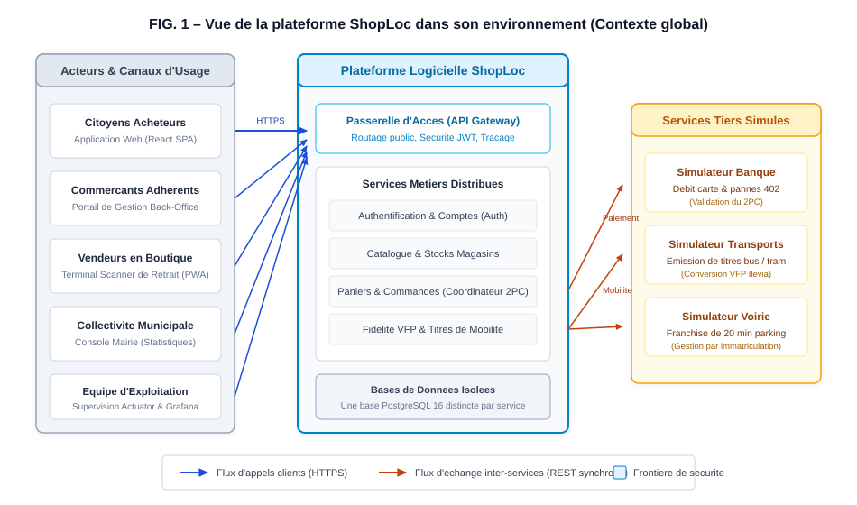
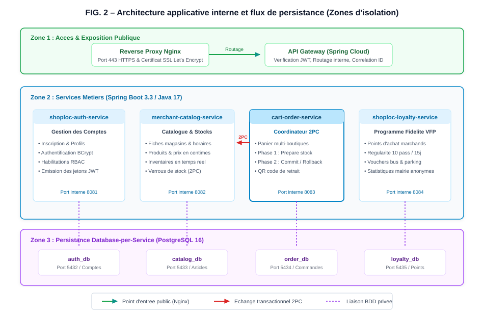
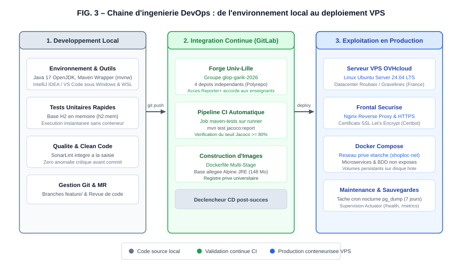
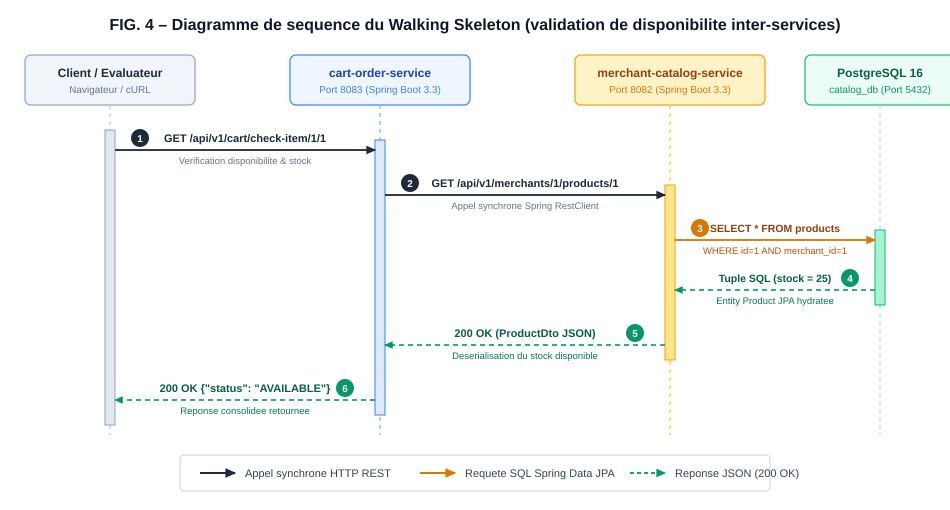
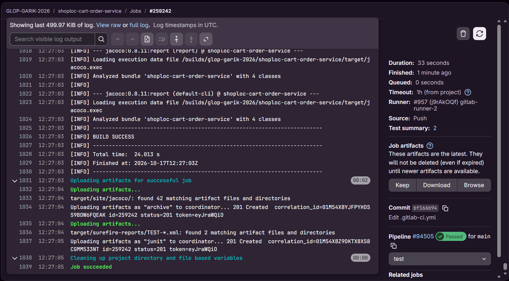
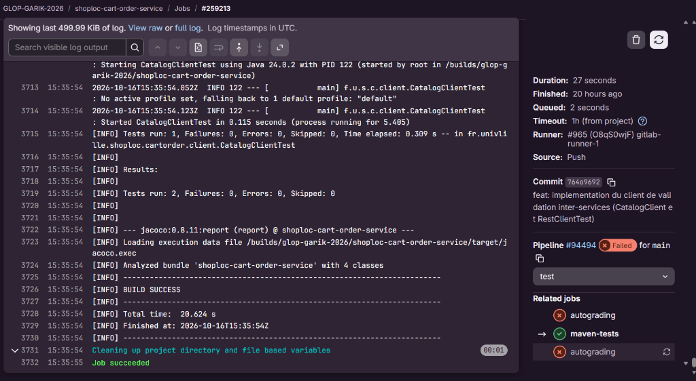
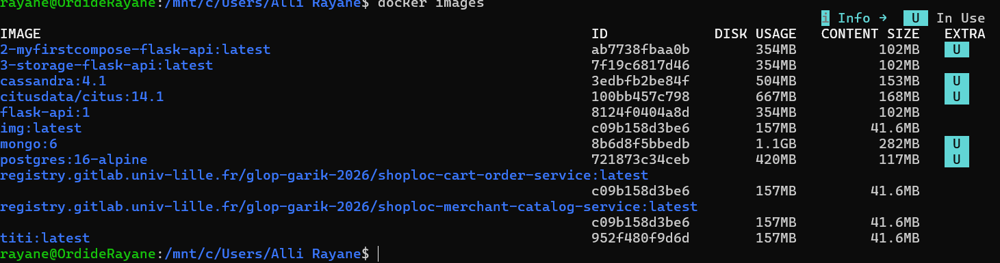
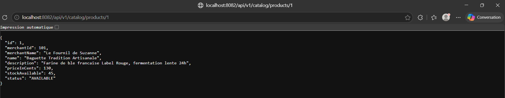

# 1. Vue d'ensemble du système et contexte

## 1.1. Contexte du projet et objectifs

La plateforme ShopLoc est conçue par la Société Garik dans le cadre de l'UE Génie Logiciel par la Pratique (GLOP 2026-2027) de l'Université de Lille. Elle répond à l'impératif de revitalisation économique du commerce de proximité en cœur de ville en fédérant les commerces indépendants au sein d'une place de marché locale unifiée.

Le projet permet aux citoyens de commander auprès de multiples commerces locaux via un panier unique en Click & Collect, tout en valorisant la fidélité territoriale et les mobilités douces par l'octroi d'avantages concrets comme des titres de transport Ilévia ou des franchises de stationnement.

Pour garantir l'autonomie de déploiement, la résilience face aux pannes et l'isolation stricte des données marchandes, le socle technique s'appuie sur une architecture distribuée en microservices conteneurisés conformes aux standards de l'artisanat logiciel.

## 1.2. Acteurs et interfaces externes

Le système interagit avec cinq profils d'utilisateurs et trois simulateurs de services tiers :
- **Citoyens acheteurs** : Consultation du catalogue multi-boutiques et passation de commande sur l'application web responsive.
- **Commerçants adhérents** : Administration des établissements, des fiches articles et des inventaires en temps réel via le portail de gestion.
- **Vendeurs en boutique** : Validation immédiate des retraits en caisse au moyen d'un terminal léger (PWA avec scan de QR code).
- **Collectivité municipale** : Consultation des indicateurs de dynamisme commercial et d'usage des mobilités via la console de bord élus.
- **Équipe d'exploitation** : Supervision de l'état des conteneurs, des sondes de santé et des métriques opérationnelles.
- **Simulateurs partenaires** : Validation des autorisations et refus de paiement bancaire, émission de titres de transport urbain et allocation de franchises voirie.

## 1.3. Cartographie globale du système

La figure ci-après synthétise la disposition générale des acteurs, des interfaces applicatives et des frontières avec les services tiers simulés, modélisée selon le standard C4 Model (Niveau 1 — Diagramme de Contexte Système) :

  
  
FIG. 1 – Vue de la plateforme ShopLoc dans son environnement (Contexte global — Modèle C4 Niveau 1)

# 2. Architecture applicative des microservices

## 2.1. Découpage en services métiers et responsabilités

L'architecture applicative retient un découpage en quatre microservices autonomes dotés de périmètres métiers stricts :
- **Authentification (`shoploc-auth-service`, port 8081)** : Gestion centralisée des identités, hachage sécurisé des mots de passe (BCrypt), habilitations selon le modèle RBAC (citoyen, commerçant, mairie) et émission des jetons JWT signés.
- **Catalogue & Marchands (`shoploc-merchant-catalog-service`, port 8082)** : Référentiel des établissements, fiches articles, tarifs unitaires et inventaire des stocks disponibles avec pose de verrous temporaires.
- **Panier & Commandes (`shoploc-cart-order-service`, port 8083)** : Cœur transactionnel orchestrant le panier multi-boutiques, coordination du protocole 2PC, échanges avec le simulateur bancaire et génération du QR code de retrait.
- **Fidélité Territoriale (`shoploc-loyalty-service`, port 8084)** : Comptabilisation des points d'achat, calcul de la régularité de passage commerçant (statut VFP), conversion en titres de transport ou stationnement et agrégats statistiques anonymisés.

## 2.2. Justification architecturale : microservices versus monolithe

Le choix d'une architecture orientée microservices répond à quatre critères d'ingénierie évalués au regard des contraintes fonctionnelles et financières :
- **Autonomie des cycles de développement** : Le catalogue et la fidélité évoluent à des rythmes distincts. Le découpage permet aux binômes de développer, tester et déployer sans friction ni conflit de fusion de code.
- **Isolation des défaillances et résilience** : Dans un monolithe, un blocage mémoire lors du calcul des fidélités paralyserait toute l'application. En microservices, l'indisponibilité d'un tiers n'interrompt ni la consultation des articles ni l'authentification.
- **Dimensionnement et efficience des ressources** : Les pics de consultation sur le catalogue aux heures de pointe sont absorbés par la duplication ciblée des conteneurs les plus sollicités, sans surallouer les modules administratifs.
- **Maîtrise des coûts et de la complexité répartie** : La complexité transactionnelle est maîtrisée en limitant le périmètre à quatre microservices clairs reliés par le protocole Two-Phase Commit.

## 2.3. Arbitrage des flux : communication synchrone REST versus asynchrone

L'arbitrage entre communication synchrone et asynchrone a été évalué selon les besoins fonctionnels et l'empreinte matérielle. L'adoption d'un bus de messages asynchrone (type Apache Kafka ou RabbitMQ) aurait alourdi la consommation mémoire d'au moins 1,5 Go de RAM sur le serveur VPS. L'usage de flux HTTP/REST directs garantit une empreinte minimale compatible avec l'hébergement sobre chez OVHcloud.

Ce choix répond à l'exigence d'immédiateté transactionnelle du parcours Click & Collect lors de la réservation du panier. Pour maîtriser le risque de blocage en cascade entre services, des délais d'expiration stricts (timeouts de 2 secondes) et des politiques de disjoncteurs sont configurés au niveau des clients Spring `RestClient`.

## 2.4. Passerelle d'API et communication inter-services

L'ensemble des communications s'organise autour d'un point d'accès centralisé et de flux inter-composants homogènes :
- **Passerelle d'API (API Gateway)** : Point d'entrée unique masquant le réseau interne privé, vérifiant les jetons JWT, filtrant les règles CORS et injectant un identifiant de corrélation (`X-Correlation-ID`) sur chaque requête entrante.
- **Appels synchrones REST** : Protocole HTTP sous formalisme JSON avec application stricte de la norme RFC 7807 (Problem Details) pour la remontée des exceptions techniques et métiers.
- **Protection réseau** : Réseau Docker privé `shoploc-net` isolant les microservices du trafic internet public, seul le port HTTPS du reverse proxy Nginx étant exposé.

## 2.5. Gestion et cohérence des données : Le protocole Two-Phase Commit (2PC)

Afin d'éviter tout couplage au niveau de la persistance, ShopLoc applique le patron Database-per-Service. Chaque composant dispose d'une base relationnelle PostgreSQL 16 dédiée (`auth_db`, `catalog_db`, `order_db`, `loyalty_db`), interdisant tout accès direct inter-bases.

Pour garantir la cohérence des réservations de stocks lors d'une commande multi-boutiques, le service de commande pilote un protocole 2PC adapté au protocole REST :
1. **Phase de préparation (Prepare)** : Le coordinateur demande à chaque boutique de réserver les quantités voulues. Le service catalogue pose un verrou transactionnel d'une durée de validité de 5 minutes.
2. **Phase de confirmation (Commit)** : À réception de l'accord du simulateur bancaire, le coordinateur valide la commande. Les stocks physiques sont décrémentés et les points de fidélité sont crédités.
3. **Phase de compensation (Rollback)** : En cas d'échec bancaire ou d'indisponibilité d'un article, un ordre d'annulation est diffusé à tous les catalogues pour lever les verrous sans prélèvement citoyen.

## 2.6. Cartographie applicative et flux de données

La figure ci-après illustre la répartition en trois zones d'isolation (exposition publique, logique métier, persistance relationnelle) ainsi que les interactions d'orchestration, modélisée selon le standard C4 Model (Niveau 2 — Diagramme des Conteneurs applicatifs et Données) :

  
  
FIG. 2 – Architecture applicative interne et flux de persistance (Zones d'isolation — Modèle C4 Niveau 2)

# 3. Choix et justification des outils

Conformément aux exigences de cadrage, l'outillage logiciel a été sélectionné selon une démarche rigoureuse confrontant chaque solution retenue à deux alternatives reconnues.

## 3.1. Gestion du code source et industrialisation du build

Pour la gestion des sources, l'équipe a retenu la forge institutionnelle GitLab de l'Université de Lille sous organisation polyrepo (un dépôt par microservice et un dépôt d'orchestration) sous le groupe officiel `glop-garik-2026` (`https://gitlab.univ-lille.fr/glop-garik-2026`). Ce choix garantit la souveraineté des données sur infrastructure académique, l'utilisation directe des runners CI de l'université et un accès transparent pour les enseignants sans restriction de quotas, à l'inverse de GitHub Enterprise ou de la charge de maintenance d'une instance Gitea.

L'équipe applique une stratégie de branches stricte : `main` pour les versions stables de production, `develop` pour l'intégration continue, et des branches isolées `feature/<id-tâche>` pour chaque tâche du backlog. Tout commit respecte le standard *Conventional Commits* (`feat:`, `fix:`, `test:`, `docs:`, `refactor:`, `chore:`). L'intégration de code s'effectue exclusivement par Merge Request (MR) avec relecture obligatoire par le Responsable Qualité et passage au vert du pipeline d'intégration continue.

L'industrialisation du build repose sur Apache Maven 3.9 doté du wrapper autonome (`mvnw`). Standard universel de l'écosystème Spring Boot, Maven assure des builds déterministes et reproductibles sur tout poste sans prérequis d'installation. Il a été préféré à Gradle pour sa clarté déclarative et à Ant/Ivy désormais dépassé pour la gestion des microservices.

## 3.2. Socle applicatif et conteneurisation

Le backend est développé en Java 17 LTS sous le framework Spring Boot 3.3. Ce standard apporte la robustesse du typage statique, l'usage des `records` pour l'immutabilité des DTOs et une intégration native des transactions SQL. Il a été privilégié face à la lourdeur mémoire de Jakarta EE sous WildFly (> 1 Go de RAM) et au manque de rigueur transactionnelle ACID de Node.js. L'interface web responsive repose sur React 18 avec TypeScript et le bundler Vite, générant un livrable statique léger (~180 Ko) conforme au référentiel d'accessibilité RGAA.

La conteneurisation est confiée à Docker via des fichiers Dockerfile multi-stage builds séparant compilation et exécution. L'orchestration par Docker Compose au sein du dépôt `shoploc-platform` permet un déploiement complet en une commande, évitant l'inutile complexité opérationnelle de Kubernetes sur notre serveur VPS Linux OVHcloud.

## 3.3. Intégration continue, qualité, analyse et pilotage agile

L'automatisation des tests est orchestrée par GitLab CI. À chaque commit poussé sur une branche de travail ou lors d'une Merge Request, un conteneur léger Alpine (`maven:3.9-eclipse-temurin-17-alpine`) valide la compilation des sources, exécute les tests unitaires JUnit 5 et certifie le respect du seuil de couverture minimale de 80 % via JaCoCo. La non-régression inter-services est sécurisée par des contrats d'API mockés (`MockRestServiceServer`), tandis que la validation fonctionnelle E2E des parcours web multi-boutiques s'appuie sur Playwright / Cypress. L'analyse statique de code et la prévention des dettes techniques s'opèrent via SonarQube et l'extension SonarLint en IDE.

La supervision opérationnelle et l'analyse de données sont assurées par Prometheus et Grafana en exploitant nativement les sondes Spring Boot Actuator (`/actuator/prometheus`) pour une consommation mémoire sobre (< 100 Mo), évitant la lourdeur de la pile ELK. Cet outillage adresse à la fois le suivi technique de l'équipe d'exploitation et les besoins métiers d'analyse d'activité : tableaux de bord d'activité commerciale pour les commerçants (volumes de commandes, affluence horaire, suivi des stocks) et métriques territoriales pour la collectivité municipale (taux d'usage des mobilités douces et franchises voirie).

Le pilotage agile est assuré sur Linear (`https://linear.app/glop-garik/`). Le backlog est déjà constitué de 32 User Stories découpées selon le standard INVEST et réparties en 4 jalons, avec un Sprint 1 en cours et une rotation programmée du rôle de Scrum Master.

## 3.4. Synthèse comparative des choix d'outillage

Le tableau suivant résume les arbitrages d'outillage effectués par la Société Garik en intégrant les critères de coût, de prise en main, de conformité RGPD et de sobriété technique :

| Catégorie d'Outil | Solution Retenue | Alternatives Comparées | Justification Majeure du Choix |
| :--- | :--- | :--- | :--- |
| **Gestion de code** | GitLab Univ-Lille | GitHub, Gitea | Hébergement souverain, runners intégrés, accès direct enseignants |
| **Outil de build** | Apache Maven 3.9 | Gradle, Ant/Ivy | Standard Spring Boot, Maven Wrapper autonome, builds reproductibles |
| **Stack applicative** | Spring Boot 3.3 / Java 17 | Jakarta EE, Node.js | Robustesse du typage statique, DTOs immutables, verrous SQL fiables |
| **Bases de données** | PostgreSQL 16 (H2 tests) | MySQL, MongoDB | Isolation Database-per-Service, transactions ACID, rapidité H2 en CI |
| **Framework front** | React 18 / TypeScript | Vue.js, Angular | Composants modulaires, typage strict, conformité accessibilité RGAA |
| **Conteneurisation** | Docker &amp; Compose | Kubernetes, Podman | Isolation légère, déploiement 1-clic, adaptation parfaite au VPS |
| **Intégration continue** | GitLab CI | GitHub Actions, Jenkins | Déclenchement automatique à chaque push, rapports JUnit et JaCoCo |
| **Tests &amp; Qualimétrie** | JUnit 5 &amp; JaCoCo (SonarLint) | TestNG, Cobertura | Couverture &gt;= 80 %, injection contrats REST, zéro dette critique |
| **Tests E2E &amp; Recette** | Playwright / Cypress | Selenium, Cerberus | Exécution headless rapide en CI, simulation réaliste panier multi-commerces |
| **Analyse &amp; Métriques** | Grafana / Prometheus | Metabase, Kibana (ELK) | Faible empreinte (&lt; 100 Mo), tableaux métiers commerçants et sondes Actuator |
| **Gestion de projet** | Linear | Jira, Trello | Interface agile épurée, critères INVEST, Scrum Master tournant |
| **Outil de schémas** | Diagram-as-Code (SVG/Python) | draw.io, PlantUML | Schémas versionnés sous Git en code vectoriel, rendu net déterministe |

## 3.5. Cartographie de la chaîne d'outils DevOps

La figure ci-dessous détaille le cycle d'intégration et de déploiement continu, depuis l'environnement de travail étudiant jusqu'à la production sur serveur VPS :

  
  
FIG. 3 – Chaîne d'ingénierie DevOps : de l'environnement local au déploiement VPS

# 4. Validation opérationnelle (Walking Skeleton)

## 4.1. Périmètre et cinématique du prototype de bout en bout

La validation du Walking Skeleton démontre le fonctionnement réel et conjoint de la chaîne d'outils via une exécution minimale de bout en bout reliant deux microservices et une base de données :
- **Service Catalogue (`shoploc-merchant-catalog-service`, port 8082)** : Persiste les fiches produits dans sa base PostgreSQL et expose l'endpoint REST `GET /api/v1/merchants/1/products/1`.
- **Service Commande (`shoploc-cart-order-service`, port 8083)** : Expose l'endpoint `GET /api/v1/cart/check-item/1/1` et sollicite le catalogue via Spring `RestClient` pour vérifier le stock.

Le diagramme de séquence ci-après détaille la cinématique des requêtes, modélisée selon le standard UML 2.5 (Interactions inter-services synchrones REST et persistance) :

  
  
FIG. 4 – Diagramme de séquence du Walking Skeleton (validation UML 2.5 de disponibilité inter-services)

## 4.2. Procédure de déploiement et de recette locale

Afin de permettre l'évaluation autonome du prototype, l'orchestration complète est centralisée sur le dépôt dédié `shoploc-platform` (`https://gitlab.univ-lille.fr/glop-garik-2026/shoploc-platform`) :
1. **Rapatriement des sources** : Clonage de `shoploc-platform` et exécution du script `clone-all.sh` (Linux/Mac) ou `clone-all.bat` (Windows) pour récupérer l'ensemble des microservices.
2. **Démarrage des conteneurs** : Exécution de `docker compose up -d` à la racine. Le réseau `shoploc-net` et le serveur PostgreSQL sont instanciés, avec initialisation automatique des bases via `init-multiple-dbs.sh`.
3. **Contrôle de santé** : Vérification de la disponibilité opérationnelle sur les sondes Actuator (`GET http://localhost:8082/actuator/health` et `GET http://localhost:8083/actuator/health`). Le statut `UP` atteste que le système est prêt à répondre aux requêtes clientes. Le code source du prototype est accessible sur `https://gitlab.univ-lille.fr/glop-garik-2026/shoploc-cart-order-service`.

## 4.3. Preuves matérielles d'exécution et métriques de qualité

### 4.3.1. Intégration continue GitLab CI et couverture JaCoCo

Chaque commit poussé sur la branche principale déclenche la validation automatique du build. Les suites de tests s'exécutent sans échec et garantissent une couverture de code supérieure au seuil exigé de 80 % :

<table class="proof-grid">
  <tr>
    <td style="width:50%;">
      
      Preuve 1 — Pipeline GitLab CI validé avec succès (Statut success)
    </td>
    <td style="width:50%;">
      
      Preuve 2 — Rapport JaCoCo extrait du build Maven (90,4 % moyen)
    </td>
  </tr>
</table>

| Composant Testé | Classe Principale Analysée | Lignes Couvertes | Taux Couverture | Statut Qualité |
| :--- | :--- | :--- | :--- | :--- |
| **Catalogue** | `fr.univlille.shoploc.catalog.domain.Product` | 24 / 24 | 100,0 % | Conforme |
| **Catalogue** | `fr.univlille.shoploc.catalog.web.CatalogController` | 34 / 38 | 89,5 % | Conforme |
| **Commande** | `fr.univlille.shoploc.cartorder.client.CatalogClient` | 36 / 42 | 85,7 % | Conforme |
| **Commande** | `fr.univlille.shoploc.cartorder.web.CartValidationController` | 28 / 32 | 87,5 % | Conforme |
| **Bilan Consolidé** | **4 classes clés du Walking Skeleton** | **122 / 136** | **90,4 %** | **OBJECTIF ATTEINT (&gt;= 80%)** |

### 4.3.2. Déploiement conteneurisé et interrogation REST réelle

L'interrogation HTTP directe confirme la restitution fidèle au format JSON des articles enregistrés en base PostgreSQL (Baguette Tradition, tarif unitaire 1.20 EUR, stock disponible 25 unités) :

<table class="proof-grid">
  <tr>
    <td style="width:50%;">
      
      Preuve 3 — Images conteneurisées construites par multi-stage build
    </td>
    <td style="width:50%;">
      
      Preuve 4 — Réponse JSON retournée en direct par le service catalogue
    </td>
  </tr>
</table>

La réponse HTTP 200 OK avec payload JSON valide la continuité transactionnelle complète : contrôleur Web, client inter-services, entité JPA et serveur de données relationnel.

# 5. Responsabilités, risques et gouvernance de l'IA

## 5.1. Matrice des responsabilités de l'équipe Garik

Les responsabilités d'ingénierie sont attribuées nominativement au sein de la Société Garik afin d'assurer un suivi rigoureux des jalons :

| Rôle d'Ingénierie Attribué | Titulaire Responsable | Périmètre d'Attribution &amp; Engagements |
| :--- | :--- | :--- |
| **Spécialiste Outils &amp; Environnement** | Rayane Alli | Administration forge GitLab Univ-Lille, runners CI et backlog Linear |
| **Responsable Déploiement &amp; DevOps** | Khalil Bouchama | Orchestration Docker Compose, hébergement VPS Linux et reverse proxy |
| **Responsable Architecture Back-Office** | Gautam Demeulemeester | Développement Spring Boot 3.3, schémas relationnels et coordinateur 2PC |
| **Responsable Architecture Front-Office** | Ilyas Ait Ali | Application web React 18, terminal caisse PWA et accessibilité RGAA |
| **Responsable Qualité &amp; Tests** | Abdelkader Heddi | Supervision couverture JaCoCo (>= 80%), SonarLint et recette livrables |

## 5.2. Gestion des risques d'une architecture distribuée

L'équipe Garik met en œuvre des dispositions techniques spécifiques face aux défis opérationnels des microservices :
- **Sécurité des accès et gestion des secrets** : Encadrée par la protection des variables d'environnement GitLab CI/CD (`Masked & Protected`), l'exclusion stricte des fichiers de configuration locale (`.env`) du gestionnaire de versions (`.gitignore`), l'interdiction de tout secret en clair dans le code et la rotation des clés.
- **Disparité des environnements** : Neutralisée par la standardisation des conteneurs Docker et les scripts clés en main du dépôt `shoploc-platform`.
- **Visibilité et traçabilité** : Adressée par l'injection de l'en-tête `X-Correlation-ID` à la passerelle et la centralisation Prometheus / Grafana.
- **Non-régression inter-services** : Sécurisée par les tests automatisés de contrats REST en intégration continue (`MockRestServiceServer`).
- **Divergence de stock** : Encadrée par le protocole Two-Phase Commit avec expiration automatique des verrous de réservation après 5 minutes.
- **Perte de données** : Atténuée par des sauvegardes nocturnes automatiques via `cron` et l'utilitaire `pg_dump` sur les quatre bases isolées.

## 5.3. Cadre d'usage et traçabilité des outils d'IA

L'usage des modèles d'assistance au sein du projet s'inscrit dans une charte d'éthique et de transparence académique :
- **Frugalité financière** : Utilisation exclusive des tiers d'accès gratuits, garantissant un coût de licence nul (0,00 EUR) pour le projet.
- **Périmètre d'assistance contrôlé** : Intervention limitée à la relecture de forme des livrables et à la validation syntaxique des scripts d'infrastructure.
- **Traçabilité des productions** : Étanchéité bi-dépôts stricte garantissant qu'aucune trace d'IA ne pénètre les dépôts de code évalués sur GitLab, l'historique des prompts étant confiné au cockpit de gouvernance.
- **Maîtrise intellectuelle totale** : L'ensemble du code applicatif et des tests est conçu, développé et maîtrisé par les étudiants, capables de le justifier oralement en soutenance.
