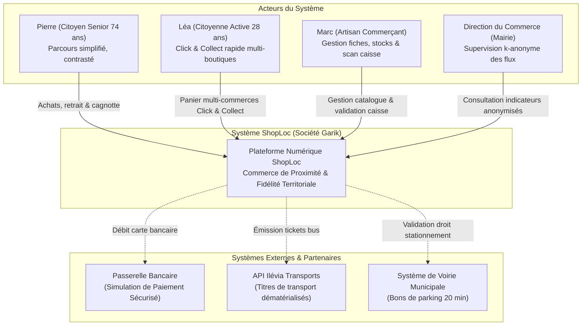
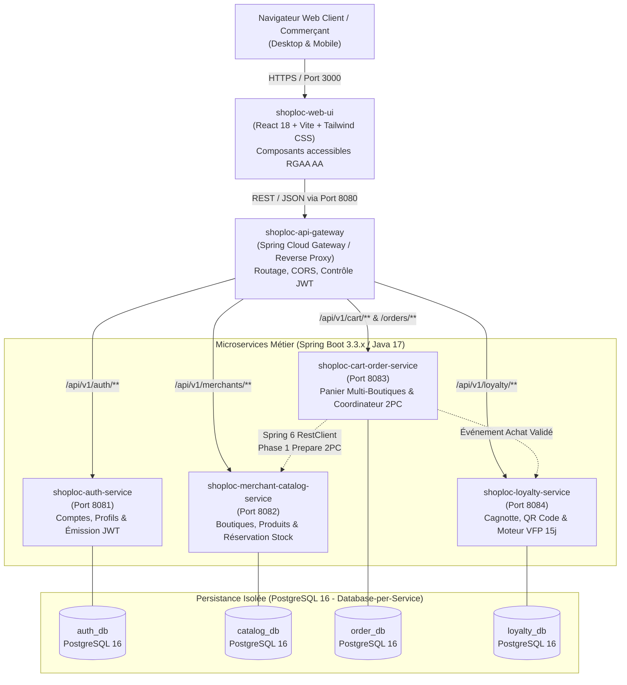
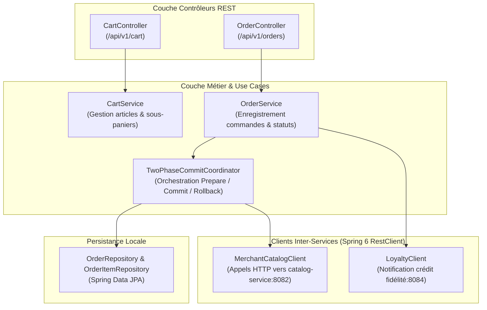
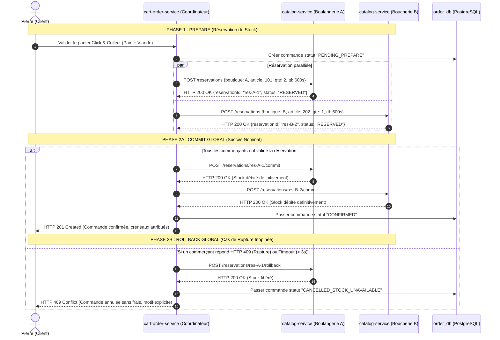

# DOSSIER D'ARCHITECTURE TECHNIQUE C4 — MICROSERVICES DISTRIBUES SHOPLOC

## 1. Contexte d'Ingénierie & Justification Architecturale

### 1.1. Contexte du Projet & Standards Universitaires
Le projet ShopLoc (Société Garik - Master 2 MIAGE, UE GLOP 2026-2027) s'inscrit dans le cadre des enseignements d'Architecture Logicielle Orientée Microservices (ALOM) de l'Université de Lille.

Initialement envisagé sous forme d'un monolithe modulaire lors du cadrage préliminaire, le projet évolue conformément aux exigences officielles de la Maîtrise d'Ouvrage académique vers une **architecture en microservices distribués avec multi-dépôts indépendants** :
1. **Isolation Stricte par Microservice (Database-per-Service)** : Chaque microservice gère son propre cycle de vie, son modèle de données relationnel dédié sous PostgreSQL 16 et ses dépendances sans aucun couplage physique.
2. **Évaluation Automatisée Indépendante (GitLab CI Autograding)** : Chaque composant dispose de son propre dépôt Git officiel GitLab Univ-Lille et de son pipeline d'évaluation unitaire automatisé (`gitlab-classrooms/autograding`).
3. **Transaction Distribuée Robuste (Two-Phase Commit - 2PC)** : Traitement de la commande multi-boutiques Click & Collect en garantissant l'atomicité des réservations de stock auprès de commerçants indépendants.

---

## 2. Modèle C4 — Niveau 1 : Diagramme de Contexte Système

Le diagramme de contexte situe ShopLoc au centre de son écosystème d'utilisateurs et de services tiers municipaux.



---

## 3. Modèle C4 — Niveau 2 : Diagramme des Conteneurs (Containers)

La solution se compose de 4 microservices métiers Spring Boot 3.3 / Java 17, d'une passerelle d'accès (*API Gateway*) et d'une interface web cliente React 18, orchestrés via Docker Compose en local.



### Inventaire des Conteneurs & Responsabilités

| Conteneur | Stack Technique | Port Interne | Base de Données | Responsabilité Métier Principale |
| :--- | :--- | :---: | :--- | :--- |
| `shoploc-web-ui` | React 18, TypeScript, Tailwind | 3000 | — | Interface utilisateur adaptative, contraste élevé (persona Pierre), panier multi-marchand. |
| `shoploc-api-gateway` | Spring Boot 3.3, Spring Cloud Gateway | 8080 | — | Point d'entrée unique, vérification des signatures JWT, routage dynamique, limitation de débit. |
| `shoploc-auth-service` | Spring Boot 3.3, Spring Security 6 | 8081 | `auth_db` | Enregistrement, authentification BCrypt, distribution de tokens JWT avec rôles (`CITOYEN`, `COMMERCANT`, `MAIRIE`). |
| `shoploc-merchant-catalog-service`| Spring Boot 3.3, Spring Data JPA | 8082 | `catalog_db` | Gestion des boutiques, référentiel produits, gestion des stocks et endpoint de réservation temporaire 2PC. |
| `shoploc-cart-order-service` | Spring Boot 3.3, Spring 6 RestClient | 8083 | `order_db` | **Cœur du MVP R4** : Assemblage du panier multi-marchand, coordination Two-Phase Commit, tunnel Click & Collect. |
| `shoploc-loyalty-service` | Spring Boot 3.3, Spring Scheduling | 8084 | `loyalty_db` | Cumul des points, QR codes sécurisés, moteur d'expiration dynamique VFP à 15 jours glissants. |

---

## 4. Modèle C4 — Niveau 3 : Composants & Focus Transactionnel 2PC

### 4.1. Architecture Interne de `shoploc-cart-order-service`
Le microservice de commande héberge le moteur de coordination transactionnelle assurant la cohérence des achats multi-commerçants.



---

### 4.2. Protocole Two-Phase Commit (2PC) : Scénarios Déroulés

Dans le cadre d'un panier groupé contenant des articles de la **Boulangerie Saint-Michel** et de la **Boucherie Centrale**, la transaction se déroule en deux étapes strictes :



---

## 5. Standards d'Interopérabilité & Conventions Techniques (Alignement ALOM)

Inspiré directement des patterns de conception du cours ALOM de l'Université de Lille, chaque microservice adhère aux principes suivants :

### 5.1. Communication Déclarative Typée (Spring 6 RestClient)
Pour éliminer les erreurs de typage et la sérialisation manuelle, les appels inter-services s'appuient sur `RestClient` et des structures de données immutables (`record` Java 17) :

```java
// Contrat DTO immutable pour l'échange inter-services
public record StockReservationRequest(
    String orderId,
    Long merchantId,
    Long productId,
    int quantity,
    int ttlSeconds
) {}

public record StockReservationResponse(
    String reservationId,
    String status,
    LocalDateTime expiresAt
) {}
```

### 5.2. Format d'Erreur Standardisé RFC 7807 (Problem Details)
Tous les microservices interceptent les exceptions métier et retournent des réponses HTTP uniformes :

```json
{
  "type": "https://api.shoploc.fr/errors/stock-unavailable",
  "title": "Stock insuffisant pour reservation 2PC",
  "status": 409,
  "detail": "L'article 202 (Pave de boeuf) chez Boucherie B ne dispose que de 0 unite disponible.",
  "instance": "/api/v1/merchants/102/reservations",
  "timestamp": "2026-10-16T13:45:00Z"
}
```

### 5.3. Injection Dynamique des Adresses de Services
Conformément aux TPs ALOM (`@Value("${service.url}")`), aucune adresse réseau n'est codée en dur dans le code source :
* En développement local : `http://localhost:8082`
* Sous Docker Compose : `http://catalog-service:8082`
* En staging / production : URL injectée par variable d'environnement Cloud.

---

## 6. Pipeline CI/CD & Démarche d'Évaluation Universitaire

Chaque dépôt de microservice intègre à sa racine le fichier `.gitlab-ci.yml` officiel des classes GitLab de l'Université de Lille :

```yaml
include:
  project: gitlab-classrooms/autograding
  file: maven-junit.yml
```

Ce pipeline exécute automatiquement à chaque commit :
1. La compilation Java 17 via Maven.
2. L'exécution complète de la suite de tests unitaires et d'intégration JUnit 5 (`mvn test`).
3. La vérification du taux de couverture de code Jacoco ($\ge 80\,\%$ exigé par notre DoD).
4. La publication de la note et du rapport de test dans l'interface de notation des enseignants.

---

## 7. Structure Multi-Dépôts dans l'Espace GLOP

L'organisation des répertoires de code pur dans l'espace de travail est la suivante :

```text
GLOP/
├── ShopLoc/                               # Cockpit de Gouvernance Garik (GitHub)
│   ├── .antigravity/                      # Directives, rôles et compétences
│   ├── .agents/skills.config.yaml         # Configuration centrale zéro-fork
│   └── agent_projet/                      # Cadrage R1, finance R3, architecture R4/R5
│
├── docker-compose.yml                     # Orchestration locale multi-conteneurs
│
├── shoploc-auth-service/                  # Dépôt GitLab Univ-Lille (Microservice Auth)
│   ├── .gitlab-ci.yml                     # Autograding officiel maven-junit
│   ├── pom.xml                            # Spring Boot 3.3, Java 17
│   └── src/                               # Code Java pur et tests JUnit 5
│
├── shoploc-merchant-catalog-service/      # Dépôt GitLab Univ-Lille (Microservice Catalogue)
│   ├── .gitlab-ci.yml
│   ├── pom.xml
│   └── src/
│
├── shoploc-cart-order-service/            # Dépôt GitLab Univ-Lille (Microservice Panier 2PC)
│   ├── .gitlab-ci.yml
│   ├── pom.xml
│   └── src/
│
└── shoploc-loyalty-service/               # Dépôt GitLab Univ-Lille (Microservice Fidélité VFP)
    ├── .gitlab-ci.yml
    ├── pom.xml
    └── src/
```

Cette organisation garantit l'**étanchéité absolue** : aucun fichier d'IA ne pénètre jamais dans les répertoires de microservices évalués.
